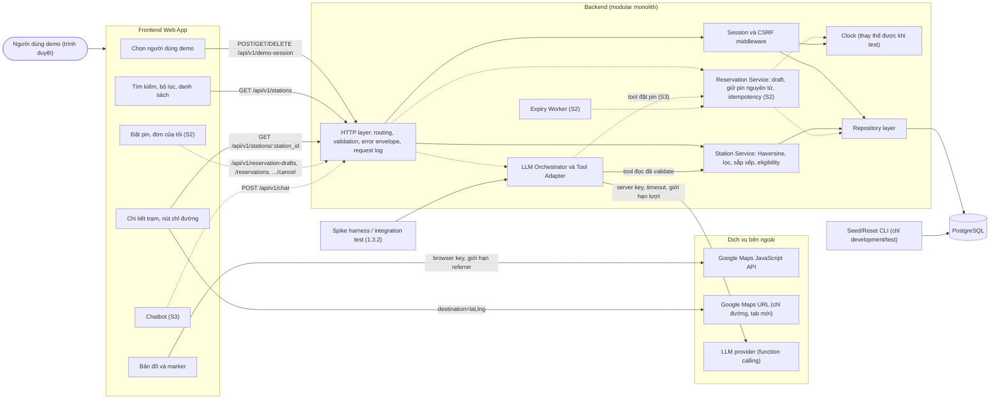
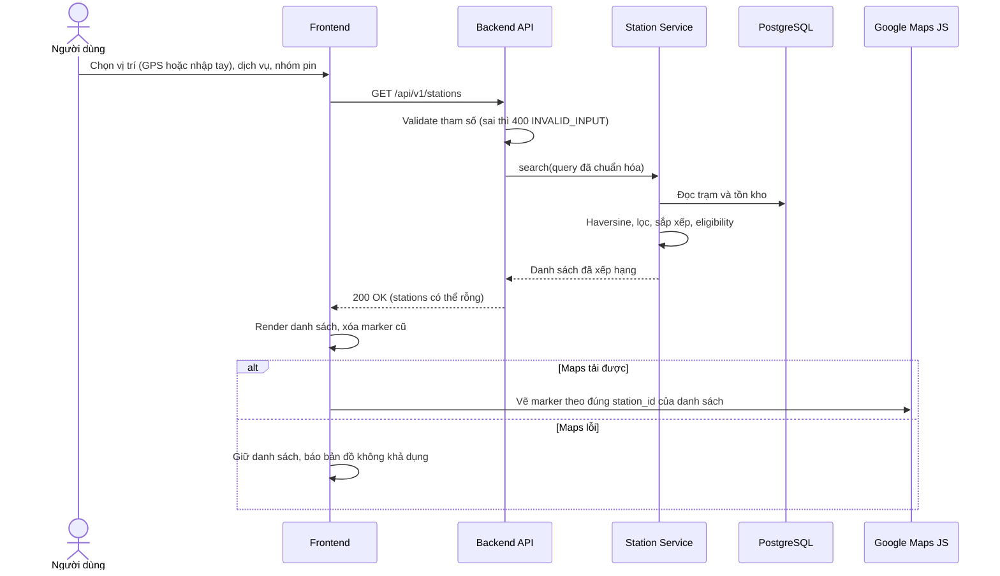
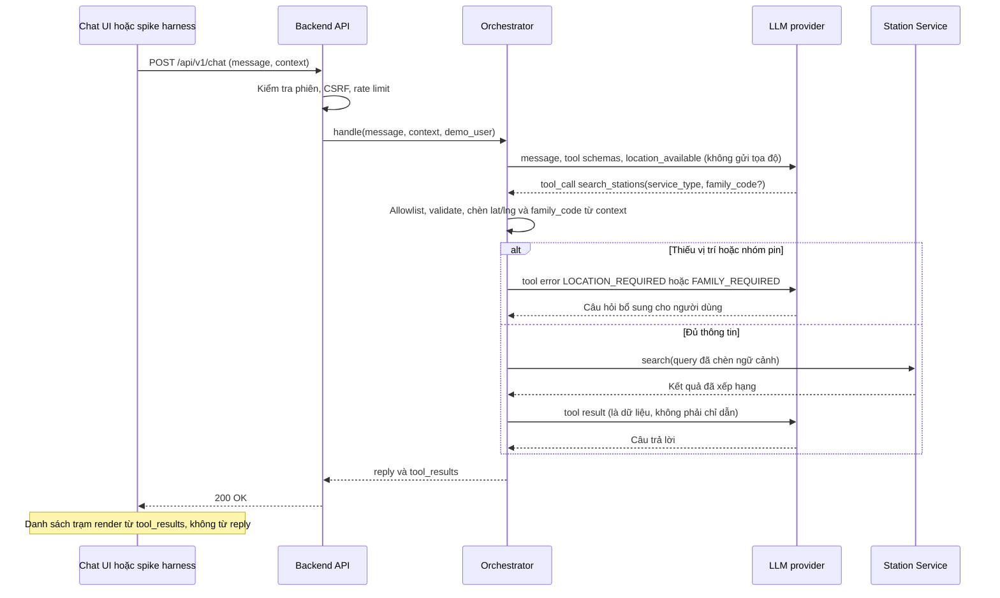

# Vinergy — Kiến trúc hệ thống & Thiết kế thành phần (1.1.2)

> **Trạng thái:** Draft v1.0 — rev 2 (Sprint 1, Task 1.1.2), chờ M4/M6 rà soát | **Phụ trách:** M2 (Vu Duy Quang)  
> **Tham chiếu:** [SRS.md](../requirements/SRS.md), [Product_Backlog.md](../requirements/Product_Backlog.md), [Acceptance_Examples_and_Sample_Data.md](../requirements/Acceptance_Examples_and_Sample_Data.md), [api_contracts.md](./api_contracts.md), [tool_schemas.json](./tool_schemas.json)  
> **Phạm vi:** Kiến trúc cho Sprint 1 và các ràng buộc kiến trúc Sprint 2–3 phải tuân theo. Chi tiết endpoint, mã lỗi và schema nằm ở [api_contracts.md](./api_contracts.md). Tài liệu mô tả thiết kế, không khẳng định đã triển khai hoặc kiểm thử.

---

## 1. Nguyên tắc kiến trúc

| Mã | Nguyên tắc | Căn cứ |
| --- | --- | --- |
| P1 | **Một lõi nghiệp vụ dùng chung.** Form, bản đồ và chatbot gọi cùng các service phía server. Mỗi quy tắc nghiệp vụ chỉ được cài một lần trong domain service, không lặp lại ở UI hoặc prompt. | FR-02, FR-11, BR-01…BR-10 |
| P2 | **Server là nguồn sự thật duy nhất.** Khoảng cách, lọc, sắp xếp, điều kiện đặt pin, tồn kho và trạng thái đơn đều do server tính. UI và LLM chỉ hiển thị. | BR-04, BR-10, FR-10 |
| P3 | **LLM chỉ đề xuất, server quyết định.** LLM chỉ gọi tool trong allowlist. Tool adapter validate lại mọi tham số. Danh tính và vị trí do server lấy từ ngữ cảnh tin cậy, không bao giờ lấy từ tham số của LLM. | BR-10, AE-14, AE-19, AE-20 |
| P4 | **Bí mật chỉ tồn tại ở server.** `LLM_API_KEY`, `DATABASE_URL`, `SESSION_SECRET` không vào bundle frontend, repository hay log. Khóa Maps phía trình duyệt là công khai theo thiết kế và phải bị giới hạn referrer/API. | NFR-03, AE-23a, AE-23b |
| P5 | **Hạ cấp có kiểm soát.** Maps lỗi không làm mất danh sách. LLM lỗi chuyển sang form thủ công. Kết quả rỗng hợp lệ luôn khác lỗi. Thao tác ghi chưa rõ kết quả không được mặc định thành công hay thất bại. | FR-12, AE-05, AE-06, AE-21 |
| P6 | **Kiểm thử được theo thiết kế.** Mọi logic thời gian đi qua `Clock` có thể thay thế. Dữ liệu demo được seed tái lập và cô lập theo môi trường. | AE-16, AE-22, NFR-07 |
| P7 | **Thu thập tối thiểu.** Không lưu hoặc ghi log vị trí chính xác và nội dung hội thoại khi không cần. Không gửi tọa độ người dùng cho LLM provider. | NFR-04, AE-23c |

---

## 2. Sơ đồ thành phần

Nét liền: có trong Sprint 1. Nét đứt: Sprint 2 (S2) hoặc Sprint 3 (S3).

---

## 3. Trách nhiệm thành phần

| Thành phần | Trách nhiệm | Sprint | Phụ trách |
| --- | --- | --- | --- |
| **SessionUI, SearchUI, MapUI, DetailUI** | Chọn người dùng demo. Lấy vị trí bằng GPS hoặc nhập tay khi bị từ chối quyền. Chọn `service_type`, `family_code`, `only_open`, `radius_km`. Render danh sách và marker theo cùng `station_id`, xóa marker cũ kể cả khi kết quả rỗng. Mở chỉ đường bằng Google Maps URL. Hiển thị nhãn dữ liệu mô phỏng. | 1 | M3 (UX), M5 (UI/Maps) |
| **HTTP layer** | Routing, parse và validate tham số theo [api_contracts.md §1.2](./api_contracts.md#12-quy-tắc-đọc-tham-số-query), chuẩn hóa error envelope, gắn `X-Request-Id`, ghi request log theo §7. | 1 | M2 (contract), M4 |
| **Session & CSRF middleware** | Tạo, đọc, hủy phiên demo. Gắn danh tính tin cậy vào request. Kiểm tra `X-CSRF-Token` cho request thay đổi trạng thái. | 1 | M4 |
| **Station Service** | Tính Haversine (R = 6371 km) trên giá trị chưa làm tròn. Lọc theo dịch vụ, nhóm pin, trạng thái, bán kính. Sắp xếp `(distance_km ASC, station_id ASC)`. Tính `booking_eligible` theo thuật toán duy nhất ở [api_contracts.md §4.2](./api_contracts.md#42-thuật-toán-điều-kiện-đặt-pin). | 1 | M4 |
| **LLM Orchestrator & Tool Adapter** | Gửi message và tool schema tới provider. Chỉ chấp nhận tool trong allowlist. Validate tham số bằng cùng validator với HTTP layer. Chèn danh tính, vị trí và nhóm pin mặc định từ ngữ cảnh. Gọi service trực tiếp trong tiến trình (không gọi vòng qua HTTP). Áp dụng timeout, giới hạn lượt và rate limit. | Spike 1, đầy đủ 3 | M6, M2 (contract) |
| **Reservation Service** | Bản nháp không giữ tồn kho. Xác nhận nguyên tử (`quantity = 1`). Idempotency theo `(user, operation, key)`. Hủy và hết hạn hoàn pin đúng một lần. Đối soát đơn quá hạn khi đọc/hủy (BR-09). | 2 | M4, M6, M2 |
| **Expiry Worker** | Chạy định kỳ, chuyển đơn `ACTIVE` quá hạn sang `EXPIRED` bằng cùng thao tác có điều kiện với Reservation Service. Phục hồi phi trạng thái bằng cách quét lại toàn bộ đơn quá hạn khi khởi động và ở mỗi chu kỳ. Chu kỳ và độ trễ tối đa chốt ở 2.1.3. | 2 | M6 |
| **Clock** | Nguồn thời gian duy nhất (`now()` theo UTC), dùng cho `Session`, `Reservation Service` và rate limiter. Test dùng đồng hồ giả lập để kiểm tra mốc hết hạn (AE-16). | 1 | M4 |
| **Repository & PostgreSQL** | Lưu trạm, tồn kho theo nhóm, phiên, bản nháp, đơn, khóa idempotency. Toàn bộ thao tác giữ/hoàn pin thực hiện trong transaction (AD-09). | 1 (trạm, phiên), 2 (đặt pin) | M4 |
| **Seed/Reset CLI** | Nạp [seed_stations_v0.json](../../data/seed_stations_v0.json) vào DB. Từ chối chạy khi `APP_ENV` không phải `development` hoặc `test`, hoặc khi thiếu cờ xác nhận `--confirm-reset`. Không có endpoint HTTP tương ứng (FR-13, AE-22). | 1 (seed), 3 (reset có bảo vệ) | M4, M1 |
| **Spike harness** | Chạy kịch bản gọi tool có kiểm soát cho 1.3.2 và ghi lại bằng chứng. Không phải chatbot hoàn chỉnh (FR-05). | 1 | M6 |

---

## 4. Luồng chính

### 4.1. Tìm kiếm qua form và bản đồ (UC-01)

Lỗi `5xx` hoặc timeout mạng hiển thị trạng thái lỗi kèm nút thử lại, không hiển thị như kết quả rỗng (AE-05).

### 4.2. Gọi tool qua LLM (spike 1.3.2, đầy đủ ở Sprint 3)

Provider lỗi hoặc quá thời gian trả `503`/`504` kèm `fallback: "MANUAL_FORM"` ([api_contracts.md §5.6](./api_contracts.md#56-post-apiv1chat-tạm-thời)).

---

## 5. Quyết định kiến trúc (AD)

| Mã | Quyết định | Lý do | Hệ quả / ràng buộc | Trạng thái |
| --- | --- | --- | --- | --- |
| AD-01 | **Modular monolith:** một backend deploy được, chia module `station`, `session`, `chat`, `reservation`. Module chỉ gọi nhau qua service interface, không đọc bảng của module khác. | Nhóm 7 người, 6 tuần, 18 bản ghi. Microservice chỉ thêm chi phí vận hành. | Một tiến trình, một DB. Ranh giới module giữ cho code dễ tách khi cần. | Đề xuất |
| AD-02 | **PostgreSQL** cho mọi môi trường (development/test chạy bằng container). | BR-07/BR-08 cần transaction, khóa dòng và unique constraint. Test race AE-13 phải chạy trên cùng engine với bản demo. SQLite không đại diện được cho truy cập đồng thời. | Integration test cần DB thật, không dùng mock. | Đề xuất, M4 xác nhận ở 1.1.3 |
| AD-03 | **Tính Haversine trong Station Service** trên toàn bộ trạm, không dùng PostGIS hay truy vấn không gian. | 18 bản ghi. Dễ kiểm thử trực tiếp với giá trị đối chiếu của AE. | Cần xem lại nếu dữ liệu tăng lên hàng nghìn bản ghi. | Chốt |
| AD-04 | **Phiên demo bằng cookie phía server và CSRF token** (chi tiết §6). | BR-10, AE-14: danh tính không được do client hoặc LLM tự khai trong từng request. | Không có header danh tính do client đặt. Mọi `user_id` trong body, query hoặc tham số tool đều bị bỏ qua. | Chốt |
| AD-05 | **Ngữ cảnh do orchestrator chèn:** `user`, `location` và `family_code` mặc định đến từ phiên và UI. Tool schema không có `user_id`, `lat`, `lng`. | Ngăn LLM bịa tọa độ hoặc danh tính (AE-19, AE-20) và không gửi vị trí cho bên thứ ba (NFR-04). | Chat UI phải gửi `context.location` khi người dùng đã chọn vị trí. | Chốt |
| AD-06 | **Một nguồn chuẩn cho ràng buộc đầu vào:** một module validator dùng chung cho HTTP và tool adapter. CI có contract test đối chiếu enum và giới hạn của validator với [tool_schemas.json](./tool_schemas.json), và kiểm tra response mẫu của [api_contracts.md](./api_contracts.md) theo `result_schemas`. | Tránh lệch giữa bảng tham số, JSON schema và code. | Đổi ràng buộc phải sửa validator, schema và tài liệu trong cùng một PR. | Chốt |
| AD-07 | **Clock abstraction:** mọi logic thời gian (`expires_at`, TTL phiên, hết hạn bản nháp) gọi `Clock.now()`. Lưu thời gian dạng UTC. | AE-16 yêu cầu đồng hồ server điều khiển được. | Cấm gọi trực tiếp giờ hệ thống trong domain code. | Chốt |
| AD-08 | **Chỉ đường bằng Google Maps URL** `https://www.google.com/maps/dir/?api=1&destination=<lat>,<lng>`, không dùng Directions API. | SRS chỉ yêu cầu mở chỉ đường bên ngoài. Không tốn khóa hay quota, và vẫn dùng được khi Maps JS lỗi (AE-06). | Chỉ bật Maps JavaScript API cho browser key. | Chốt |
| AD-09 | **Hướng giữ pin nguyên tử** (ràng buộc cho 2.1.3). Trong một transaction: (1) tra hoặc tạo bản ghi idempotency unique `(user_id, operation, idempotency_key)` kèm hash nội dung request; (2) cập nhật có điều kiện bản nháp `used_at IS NULL`; (3) `UPDATE battery_stock SET available = available - 1 WHERE station_id = ? AND family_code = ? AND available >= 1` và yêu cầu đúng 1 dòng bị ảnh hưởng; (4) tạo đơn với unique `draft_id`. Hoàn pin chỉ khi `UPDATE reservations SET status = ? WHERE id = ? AND status = 'ACTIVE'` ảnh hưởng đúng 1 dòng. | Đáp ứng BR-06…BR-09, AE-11, AE-13, AE-15, AE-16d mà không cần khóa phân tán. | Bước (1) chạy trước kiểm tra hạn bản nháp, đúng thứ tự của BR-08. | Đề xuất, chốt ở 2.1.3 |
| AD-10 | **Ngôn ngữ và framework:** chưa chốt (§10). Ràng buộc bắt buộc: hỗ trợ transaction PostgreSQL, có thư viện schema validation dùng được cho cả HTTP và tool, có công cụ đo coverage line và branch. | Cần thống nhất với năng lực của nhóm. | Chặn 1.3.1 nếu chưa chốt. | Mở |

---

## 6. Phiên demo & bảo mật

**Phiên demo (AD-04)**

1. Người dùng chọn `USER-A` hoặc `USER-B` trên UI. Client gọi `POST /api/v1/demo-session`. Đây là bước "đăng nhập" của bản demo. Sau bước này, danh tính **chỉ** đến từ cookie.
2. Server tạo session id ngẫu nhiên `raw_sid` (≥ 128 bit), chỉ lưu giá trị băm `HMAC-SHA256(SESSION_SECRET, raw_sid)` trong bảng `sessions`, đặt cookie `vinergy_sid=<raw_sid>` với `HttpOnly; Secure; SameSite=Lax; Path=/`. Chỉ được bỏ `Secure` khi chạy `http://localhost`. Server trả `csrf_token` ngẫu nhiên gắn với phiên.
3. Phiên hết hạn tuyệt đối sau `SESSION_TTL_MINUTES`. Phiên hết hạn trả `401 SESSION_EXPIRED` và không cho phép thay đổi dữ liệu hay xem đơn (AE-23f). Để phục hồi, UI yêu cầu chọn lại người dùng demo qua `POST /api/v1/demo-session`; các đơn đã tạo trong DB vẫn giữ nguyên theo `USER-A` / `USER-B`.
4. Endpoint tạo phiên chỉ được đăng ký khi `DEMO_LOGIN_ENABLED=true`. Nếu không, nó trả `404`.

**CSRF và CORS**

- Mọi request `POST`/`PUT`/`PATCH`/`DELETE` có phiên phải gửi header `X-CSRF-Token` khớp với phiên. Sai hoặc thiếu trả `403 CSRF_INVALID`. Ngoại lệ duy nhất là `POST /api/v1/demo-session`.
- Body request chỉ nhận `application/json`. Kiểu khác trả `415`.
- Không bật CORS: frontend và API cùng origin.

**Phân quyền và LLM**

- Đơn hoặc bản nháp của người khác trả `404`, giống như không tồn tại, để không lộ sự tồn tại hay nội dung (AE-14). Áp dụng từ Sprint 2.
- Quy tắc nghiệp vụ nằm trong service code chứ không nằm trong prompt. Vì vậy nội dung người dùng hoặc tool không thể tắt được các quy tắc này (UC-04). Kết quả tool được truyền cho LLM dưới dạng dữ liệu JSON, kèm chỉ dẫn hệ thống không làm theo chỉ dẫn nằm trong dữ liệu.

---

## 7. Quyền riêng tư & logging (chính sách ban đầu theo SRS §8)

| Dữ liệu | Mục đích | Lưu trong DB | Ghi log | Quyền truy cập | Thời hạn |
| --- | --- | --- | --- | --- | --- |
| Tọa độ tìm kiếm (`lat`, `lng`) | Tính khoảng cách | Không | **Không.** Request log ghi route template, không ghi query string. | Chỉ tiến trình backend xử lý request | Chỉ tồn tại trong request |
| `context.location` của chat | Chèn vào tool | Không | Không | Chỉ tiến trình backend xử lý request | Chỉ tồn tại trong request; không gửi cho LLM provider |
| Người dùng demo (`USER-A`/`USER-B`) | Phân quyền | Bảng `sessions` | Có (mã giả lập, không phải dữ liệu cá nhân) | Phiên hiện tại xem chính mình; log cho nhóm phát triển/kiểm thử | Đến khi phiên hết hạn |
| Session id hash, CSRF token, cookie | Xác thực phiên | Bảng `sessions` | Không | Chỉ middleware phiên đọc khi kiểm tra cookie/header | Đến khi phiên hết hạn |
| Nội dung chat (message, reply) | Trả lời người dùng | Không | Không | Chỉ phiên gửi request hiện tại | Chỉ tồn tại trong request. Spike chỉ lưu bằng chứng bằng prompt tổng hợp, không dùng dữ liệu thật. Xem lại trước 3.1.3. |
| Bản nháp, đơn đặt pin (S2) | Vòng đời đặt pin | Có | Chỉ ghi id và trạng thái | Chỉ `demo_user` sở hữu xem và thao tác (AE-14) | Đến khi reset dữ liệu demo |
| Request log | Gỡ lỗi, đo hiệu năng | Không (file hoặc stdout) | — | Nhóm phát triển và kiểm thử (M2/M4/M6/M7) | Tối đa 7 ngày hoặc đến khi reset môi trường, tùy điều kiện nào đến trước |

**Định dạng request log:** JSON một dòng gồm `timestamp`, `request_id`, `method`, `route` (template, ví dụ `/api/v1/stations/:station_id`), `status`, `duration_ms`, `error_code`, `demo_user`.

**Cấm ghi log:** query string thô, tọa độ, cookie, CSRF token, API key, `DATABASE_URL`, nội dung prompt hoặc chat, stack trace trong response.

---

## 8. Cấu hình môi trường

| Biến | Phía | Bí mật | Giá trị mặc định / ghi chú |
| --- | --- | --- | --- |
| `APP_ENV` | Server | Không | `development` \| `test` \| `demo`. Seed/Reset CLI chỉ chạy khi giá trị là `development` hoặc `test`. |
| `DATABASE_URL` | Server | **Có** | — |
| `SESSION_SECRET` | Server | **Có** | Dùng ký và bảo vệ phiên |
| `SESSION_TTL_MINUTES` | Server | Không | `480` (đề xuất) |
| `DEMO_LOGIN_ENABLED` | Server | Không | `true` ở môi trường demo/dev/test |
| `LLM_PROVIDER`, `LLM_MODEL` | Server | Không | Chưa chốt (§10) |
| `LLM_API_KEY` | Server | **Có** | Áp dụng giới hạn ngân sách/quota ở phía provider |
| `LLM_TIMEOUT_MS` | Server | Không | `15000` (đề xuất cho spike) |
| `LLM_MAX_TOOL_ROUNDS` | Server | Không | `3` mỗi lượt người dùng (đề xuất cho spike) |
| `LLM_RATE_LIMIT_PER_MINUTE` | Server | Không | `10` mỗi phiên (đề xuất cho spike) |
| `MAPS_BROWSER_KEY` | Browser | Không (công khai theo thiết kế) | Giới hạn HTTP referrer theo origin demo; chỉ bật Maps JavaScript API |

`.env` không được commit. Repository chỉ chứa `.env.example` không có giá trị bí mật.

---

## 9. Kiểm thử, độ bao phủ & đo hiệu năng

**Các tầng kiểm thử**

| Tầng | Nội dung | Dữ liệu |
| --- | --- | --- |
| Unit | Haversine, parse tham số, thuật toán eligibility và thứ tự lý do, lọc/sắp xếp, tool adapter (allowlist, chèn context) | Giá trị đối chiếu trong AE |
| Integration | API và PostgreSQL thật. Chạy AE-01…AE-07 (Sprint 1), AE-08…AE-17 (Sprint 2) | DB test seed từ `seed_stations_v0.json`, reset trước mỗi ca |
| Contract | Theo AD-06 | `tool_schemas.json`, ví dụ trong `api_contracts.md` |
| E2E | Luồng chính trên trình duyệt (Sprint 3) | Môi trường `test` |

So sánh `distance_km` với giá trị đối chiếu theo sai số tuyệt đối ≤ 1e-6.

**Độ bao phủ (NFR-08)**

- Chỉ số: line **và** branch, mỗi chỉ số ≥ 80%.
- Module được tính: `station` (distance, filter, sort, eligibility), validator dùng chung, tool adapter, session middleware. Từ Sprint 2 thêm `reservation`, idempotency và expiry.
- Loại trừ: component UI thuần hiển thị, code sinh tự động, migration, Seed/Reset CLI, wrapper mỏng quanh SDK của provider, code khởi tạo cấu hình.
- Đo trong CI ở mỗi lần merge vào nhánh chính và báo cáo ở mỗi sprint review. Ngưỡng bắt buộc đạt vào cuối Sprint 3.

**Hiệu năng (NFR-06)**

Đo thời gian xử lý tìm kiếm phía server bằng `duration_ms` trong request log, tách riêng thời gian của Maps và LLM, trên bộ 18 bản ghi. Báo cáo môi trường, cỡ mẫu, trung vị, p95 và số lần thất bại. Ngưỡng sẽ chốt sau rà soát Sprint 1; không đặt cam kết trước khi đo.

---

## 10. Quyết định còn mở

| Quyết định | Đề xuất hiện tại | Phụ trách | Hạn chốt |
| --- | --- | --- | --- |
| Ngôn ngữ và framework (AD-10) | Thỏa ràng buộc ở AD-10 | M2/M4 | Trước 1.3.1 |
| Xác nhận PostgreSQL (AD-02) | PostgreSQL | M4 | Trong 1.1.3 |
| LLM provider và model | Bắt buộc hỗ trợ function calling | M2/M6 | Trước 1.3.2 |
| Giới hạn LLM (timeout, số lượt tool, rate limit) | 15 s / 3 lượt / 10 lần mỗi phút | M2/M6 | Giá trị spike trước 1.3.2; giá trị cuối trước 3.1.3 |
| Thời gian giữ pin, hạn bản nháp | Cấu hình được, chưa đặt giá trị | M1/M2/M4 | 2.1.1/2.1.3 |
| Chu kỳ Expiry Worker, độ trễ hoàn pin tối đa, phục hồi khi lỗi | Theo AD-09 và BR-09 | M2/M6/M7 | 2.1.3 |
| Giới hạn một đơn `ACTIVE` mỗi người | Không giới hạn (đúng baseline SRS) | M1/M2 | 2.1.1 |
| Lưu nội dung hội thoại ở Sprint 3 | Mặc định không lưu | M2/M7 | Trước 3.1.3 |
| Ngưỡng độ trễ | Theo kết quả đo ở §9 | M2/M7 | Sau rà soát Sprint 1, trước 3.3.2 |
| Xác nhận phạm vi và loại trừ coverage | Theo đề xuất ở §9 | M2/M7 | Trước 1.3.1 / 1.3.3 |

---

## 11. Lịch sử thay đổi

| Bản | Ngày | Nội dung |
| --- | --- | --- |
| rev 1 | — | Bản nháp đầu tiên |
| rev 2 | 2026-11-13 | Thêm Session/CSRF, Clock, Expiry Worker, Seed/Reset CLI và spike harness vào sơ đồ. Sửa endpoint đặt pin cho khớp contract. Thêm luồng chính, quyết định kiến trúc AD-01…AD-10, chính sách quyền riêng tư/quyền truy cập/log, cơ chế hash session và phục hồi khi hết hạn, cấu hình môi trường, phạm vi coverage và quyết định còn mở. Chuyển chỉ đường sang Google Maps URL. |
