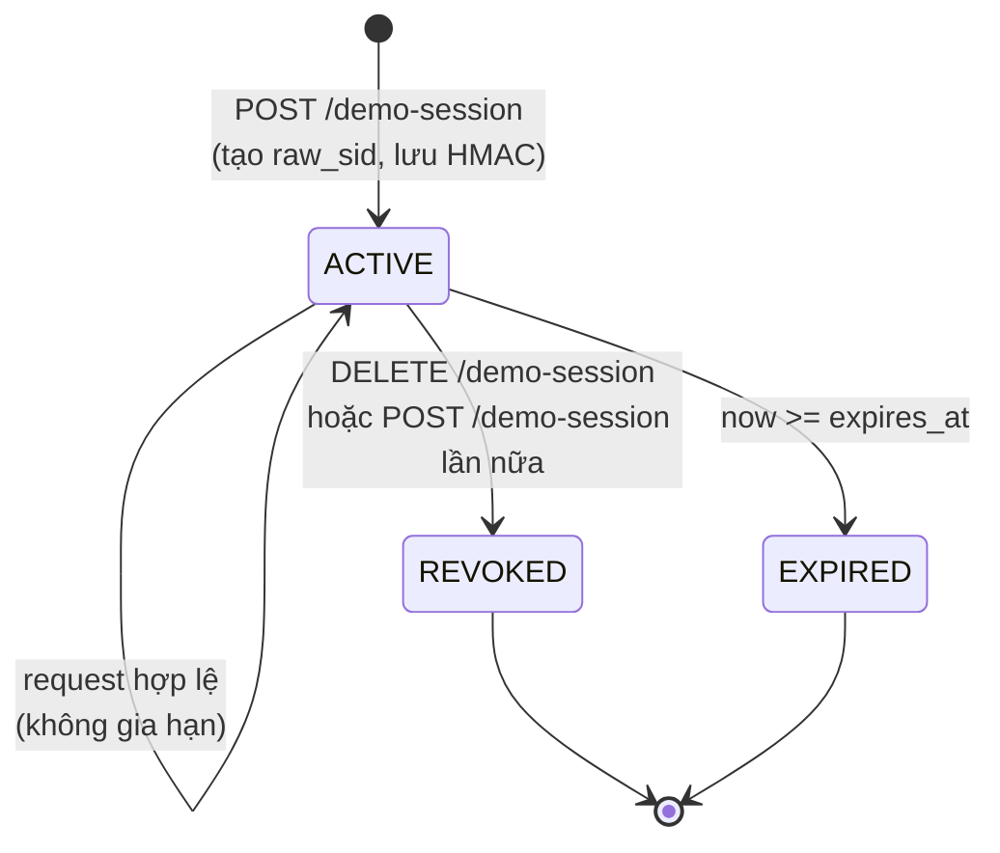
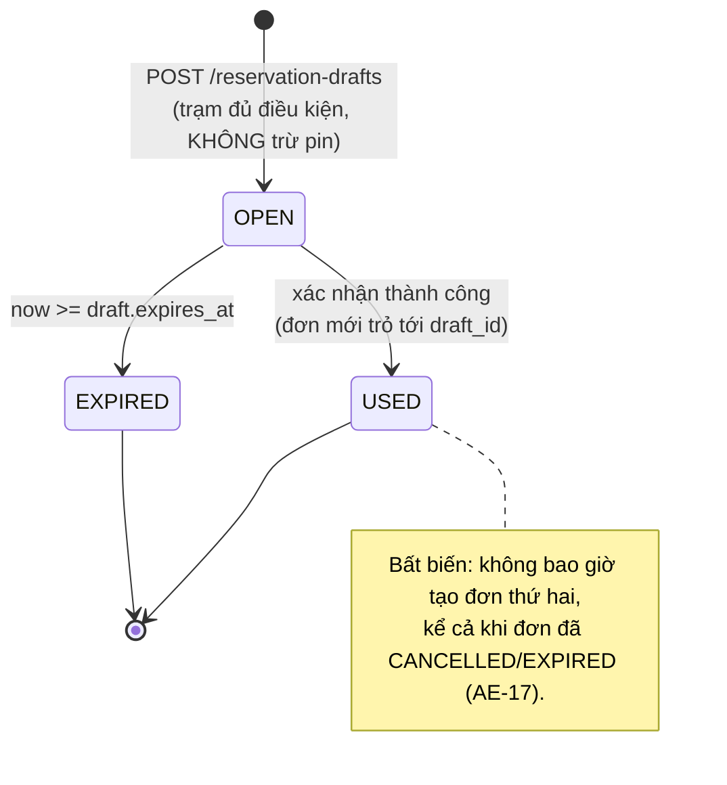
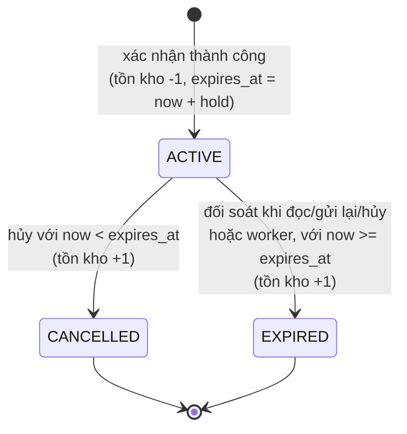
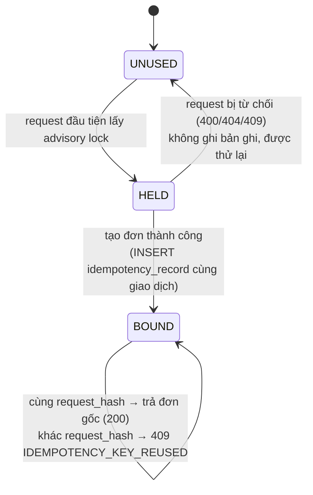
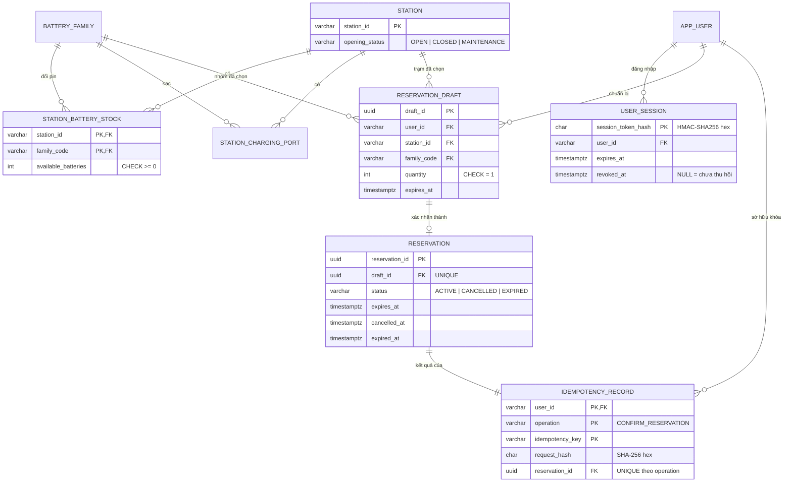
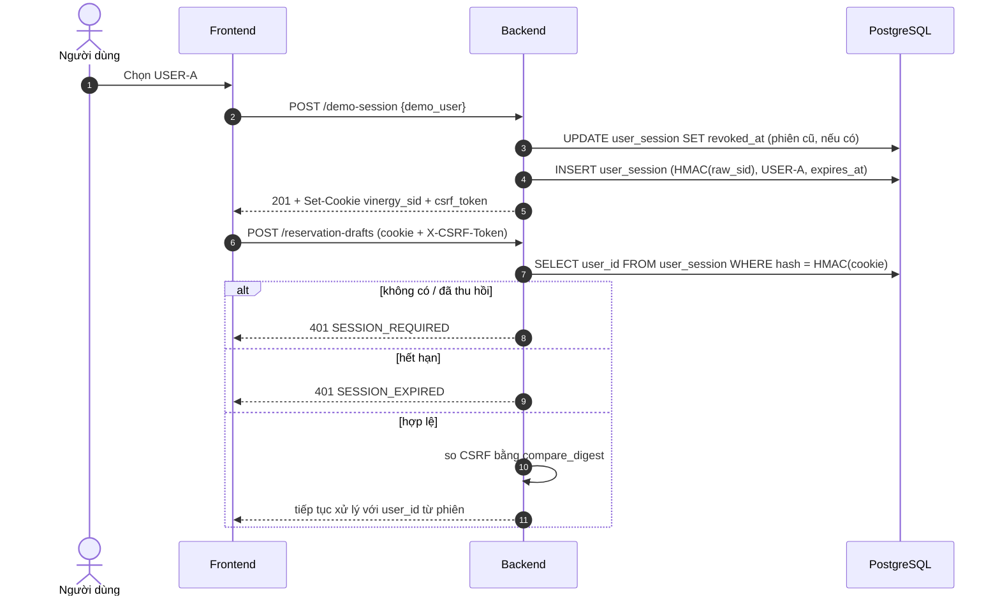
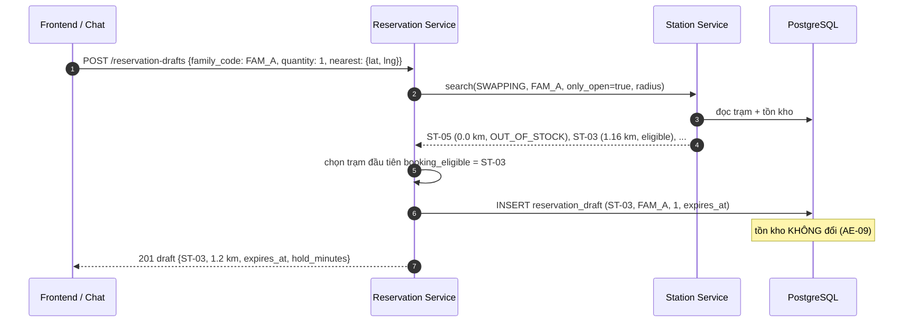
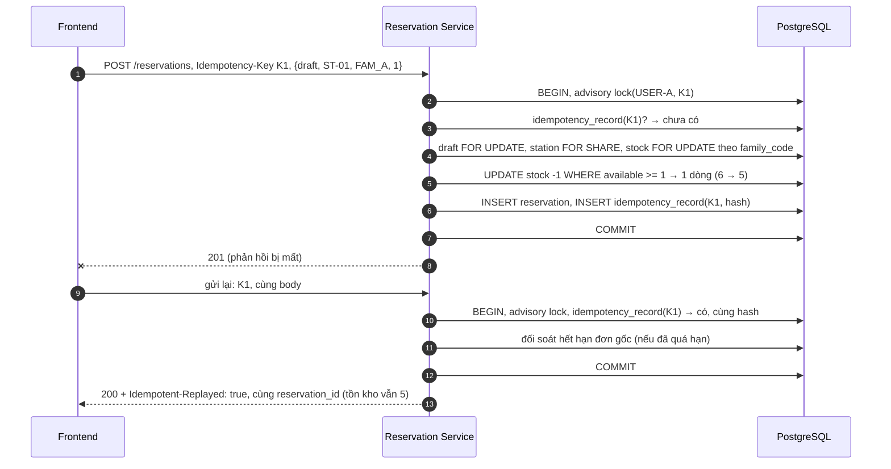
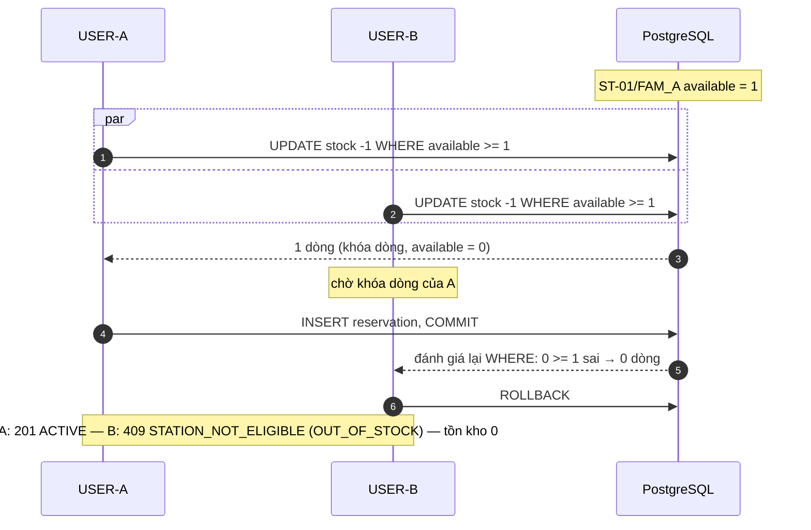
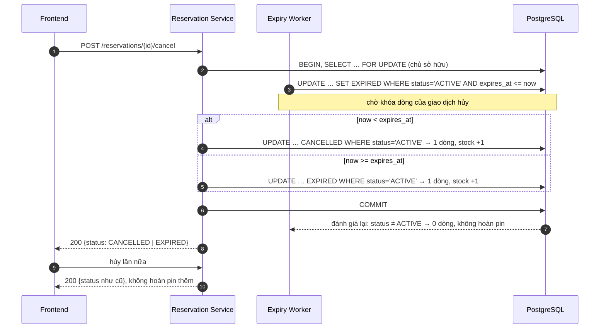

# Vinergy — Thiết kế đặt pin: trạng thái, dữ liệu và giao dịch (WBS 2.1.3)

> **Trạng thái:** Draft v2.2 (Sprint 2, Task 2.1.3), đã đối chiếu 2.1.1 (`840319d`) và góp ý review 25/11, chờ rà soát | **Phụ trách:** M4 (Bui Quang Minh), rà soát cùng M1, M2, M3, M6, M7
> **Tham chiếu:** [SRS.md](../requirements/SRS.md) v0.4 BR-05…BR-10, FR-06…FR-09, §8; [Acceptance_Examples_and_Sample_Data.md](../requirements/Acceptance_Examples_and_Sample_Data.md) v0.4 AE-08…AE-18 (gồm AE-09a, AE-10a, AE-10b, AE-11a của 2.1.1); [architecture.md](../architecture/architecture.md) AD-04, AD-07, AD-09; [api_contracts.md](../architecture/api_contracts.md) §3, §6; [Database_Design.md](./Database_Design.md)
> **Phạm vi:** Thiết kế mà 2.2 (M2/M5/M6) dùng để triển khai form đặt pin, xem, hủy và hết hạn đơn. Hợp đồng HTTP chi tiết nằm ở [api_contracts.md §6](../architecture/api_contracts.md#6-đặt-pin-sprint-2). Tài liệu này giải thích **vì sao** và **giao dịch chạy thế nào**.

Các giá trị đánh dấu **(đề xuất M1, SRS §8)** lấy từ 2.1.1 (24/11/2026). SRS ghi chúng còn chờ M1/M2/M4 xác nhận; nếu nhóm đổi giá trị thì chỉ đổi cấu hình, không đổi thiết kế.

---

## 1. Tóm tắt quyết định

| # | Quyết định | Lý do | Quy tắc |
| --- | --- | --- | --- |
| D-01 | Bản nháp **bất biến**. Đổi trạm, nhóm pin hay số lượng = tạo bản nháp mới. Bỏ `draft_revision` khỏi hợp đồng. | Mỗi `draft_id` chỉ có một nội dung, nên "phiên bản" chính là `draft_id`. Không cần cột revision, không có cập nhật đồng thời trên bản nháp. | BR-06, AE-17 |
| D-02 | Body xác nhận lặp lại `station_id`, `family_code`, `quantity` của bản nháp. Server so với bản nháp; lệch thì từ chối `DRAFT_STALE` (`CONTENT_MISMATCH`). | Ràng buộc xác nhận với đúng nội dung người dùng đã thấy, và cho `request_hash` ý nghĩa nghiệp vụ (AE-12). | BR-06, BR-08 |
| D-03 | Tạo bản nháp chỉ thành công khi trạm **đủ điều kiện đặt pin tại thời điểm đó**, nhưng **không trừ tồn kho**. | Không đưa ra đề xuất chắc chắn thất bại (AE-03: ST-02 bị từ chối ngay khi tạo bản nháp). Xác nhận vẫn kiểm tra lại nguyên tử. | BR-06, BR-07 |
| D-04 | Idempotency dùng **advisory lock theo (người dùng, thao tác, khóa)** đầu giao dịch, và chỉ ghi `idempotency_record` khi tạo đơn thành công. | Yêu cầu cùng khóa chạy đồng thời xếp hàng thay vì cùng tạo đơn. Không cần trạng thái "đang xử lý" trong DB nên lược đồ v0 giữ nguyên. | BR-08, AE-11 |
| D-05 | Mọi chuyển trạng thái của đơn là `UPDATE … WHERE status = 'ACTIVE'` có điều kiện thời gian. Chỉ khi đúng 1 dòng thay đổi mới hoàn pin, trong **cùng câu lệnh/giao dịch**. | Hủy, đối soát khi đọc và tác vụ nền chạy đua vẫn chỉ hoàn pin một lần. | BR-09, AE-15, AE-16d |
| D-06 | Thời gian quyết định hủy hay hết hạn là `Clock.now()` của server, lấy **một lần** ở đầu giao dịch và truyền vào SQL. Không dùng `now()` của DB trong logic nghiệp vụ. | Đồng hồ điều khiển được trong test (AE-16), và CHECK của bảng `reservation` dùng cùng mốc. | AD-07, BR-09 |
| D-07 | CSRF token **suy ra** từ session id: `HMAC(SESSION_SECRET, "csrf:" + raw_sid)`. Không thêm cột. | Bảng `user_session` v0 đủ dùng, và `GET /demo-session` luôn trả lại được token. | AD-04 |
| D-08 | Không giới hạn số đơn `ACTIVE` mỗi người: mỗi bản nháp hợp lệ, còn tồn kho tạo được một đơn riêng. Giữ sẵn cấu hình và mã lỗi nếu nhóm đổi chính sách. | Đề xuất M1 ở 2.1.1 (SRS §8), chờ M1/M2 xác nhận. | AE-08, AE-11, AE-11a |
| D-09 | Bản nháp tham chiếu trạm và nhóm pin riêng. Giao dịch xác nhận đánh giá lại điều kiện đổi pin trước khi trừ kho. | Giữ lịch sử bản nháp khi trạm đổi dịch vụ hoặc ngừng hỗ trợ một nhóm pin. | AE-10a, §5 và §8.4 |

---

## 2. Cấu hình

| Biến | Mặc định | Ghi chú |
| --- | --- | --- |
| `SESSION_TTL_MINUTES` | `480` | Đã có ở architecture §8. Hết hạn tuyệt đối, không gia hạn trượt. |
| `DRAFT_TTL_MINUTES` | `5` **(đề xuất M1, SRS §8)** | Hạn xác nhận bản nháp, tính từ lúc tạo: `expires_at = created_at + 5 phút`. Có hiệu lực đến **ngay trước** mốc này (AE-09a: tạo 10:00, xác nhận đúng 10:05 bị từ chối). |
| `RESERVATION_HOLD_MINUTES` | `15` **(đề xuất M1, SRS §8)** | Thời gian giữ pin, tính từ lúc **xác nhận thành công**, độc lập với hạn nháp: `reservation.expires_at = reservation.created_at + 15 phút` (AE-10b: xác nhận 10:04 → giữ đến 10:19). |
| `EXPIRY_SWEEP_INTERVAL_SECONDS` | `30` **(đề xuất, chờ M2/M6/M7)** | Chu kỳ tác vụ nền. |
| `EXPIRY_MAX_RELEASE_DELAY_SECONDS` | `60` **(đề xuất, chờ M2/M6/M7)** | Cam kết: đơn không ai truy cập được hoàn pin trong tối đa 60 s sau `expires_at` khi worker hoạt động bình thường (AE-16c). |
| `IDEMPOTENCY_LOCK_TIMEOUT_MS` | `5000` | Chờ yêu cầu cùng khóa quá thời gian này thì trả `409 REQUEST_IN_PROGRESS` kèm `Retry-After: 1`. |
| `MAX_ACTIVE_RESERVATIONS_PER_USER` | `0` (không giới hạn, đề xuất M1) | Chỉ đổi khi nhóm quyết định giới hạn (§8.3). |

---

## 3. Sơ đồ trạng thái

### 3.1 Phiên demo



| Trạng thái | Cách nhận biết trong `user_session` | Request kèm cookie này nhận |
| --- | --- | --- |
| `ACTIVE` | `revoked_at IS NULL AND now < expires_at` | Được xử lý |
| `REVOKED` | `revoked_at IS NOT NULL` | `401 SESSION_REQUIRED` |
| `EXPIRED` | `revoked_at IS NULL AND now >= expires_at` | `401 SESSION_EXPIRED` (AE-23f) |
| — | Không tìm thấy hash | `401 SESSION_REQUIRED` |

Trạng thái được suy ra, không lưu cột `status`. Đơn và bản nháp gắn với `user_id`, không gắn với phiên, nên đăng nhập lại `USER-A` vẫn thấy đơn cũ.

### 3.2 Bản nháp



| Trạng thái | Suy ra từ | Xác nhận với khóa **mới** nhận |
| --- | --- | --- |
| `OPEN` | Chưa có `reservation` nào có `draft_id` này và `now < expires_at` | Tiếp tục kiểm tra trạm và tồn kho |
| `USED` | Có `reservation.draft_id` = bản nháp (`UNIQUE`) | `409 DRAFT_ALREADY_USED` |
| `EXPIRED` | Chưa dùng và `now >= expires_at` | `409 DRAFT_STALE` (`DRAFT_EXPIRED`) |

`USED` được ưu tiên hơn `EXPIRED`: một bản nháp đã dùng thì luôn báo đã dùng. Gửi lại với **khóa cũ** không đi qua bảng này mà trả về đơn gốc (§6.3).

### 3.3 Đơn đặt pin



| Chuyển | Điều kiện nguyên tử | Hiệu ứng | Ràng buộc DB bảo vệ |
| --- | --- | --- | --- |
| tạo → `ACTIVE` | Bản nháp `OPEN`, trạm `OPEN`, `available_batteries >= 1` | Tồn kho −1 | `ck_battery_stock_nonneg`, `uq_reservation_draft` |
| `ACTIVE` → `CANCELLED` | `status = 'ACTIVE' AND :now < expires_at` | Tồn kho +1 | `ck_reservation_state` (`cancelled_at < expires_at`) |
| `ACTIVE` → `EXPIRED` | `status = 'ACTIVE' AND :now >= expires_at` | Tồn kho +1 | `ck_reservation_state` (`expired_at >= expires_at`) |
| `CANCELLED`/`EXPIRED` → bất kỳ | Không có | Không | Điều kiện `status = 'ACTIVE'` không khớp, 0 dòng |

Hai điều kiện thời gian **loại trừ nhau** theo cùng `:now`, nên một yêu cầu hủy tại hoặc sau E không bao giờ ra `CANCELLED` (AE-16b). Hủy lặp lại hoặc hủy đơn đã kết thúc trả `200` với trạng thái hiện tại, không hoàn pin thêm (AE-15).

### 3.4 Khóa idempotency



`HELD` chỉ tồn tại trong bộ nhớ của PostgreSQL trong thời gian giao dịch chạy (advisory lock tự nhả khi commit/rollback). Request cùng khóa đến lúc đó **chờ**, rồi thấy `BOUND` và trả đơn gốc (AE-11, trường hợp đồng thời).

---

## 4. Phiên demo và phân quyền

### 4.1 Cơ chế phiên (AD-04, BR-10)

| Thành phần | Thiết kế |
| --- | --- |
| Session id | `raw_sid` = 32 byte ngẫu nhiên (`secrets.token_bytes`), mã hóa base64url trong cookie `vinergy_sid` |
| Lưu trữ | `user_session.session_token_hash` = `HMAC-SHA256(SESSION_SECRET, raw_sid)` dạng hex (64 ký tự, khớp `CHAR(64)`). **Không** lưu `raw_sid`. |
| Cookie | `HttpOnly; Secure; SameSite=Lax; Path=/; Max-Age = SESSION_TTL_MINUTES × 60`. Bỏ `Secure` chỉ khi chạy `http://localhost`. |
| CSRF | `csrf_token` = base64url(`HMAC-SHA256(SESSION_SECRET, "csrf:" + raw_sid)`). Kiểm tra bằng `hmac.compare_digest`. |
| Hết hạn | Tuyệt đối: `expires_at = created_at + SESSION_TTL_MINUTES`. |
| Đăng nhập lại | `POST /demo-session` khi đang có cookie hợp lệ: đặt `revoked_at = now` cho phiên cũ rồi tạo phiên mới trong cùng giao dịch. |
| Đăng xuất | `DELETE /demo-session`: đặt `revoked_at`, xóa cookie. |
| Danh tính trong mọi request | **Chỉ** từ `user_session.user_id` tra theo hash cookie. Mọi `user_id`/`owner`/`demo_user` trong body, query hay tham số tool không bao giờ được dùng để phân quyền; ở endpoint HTTP chúng bị từ chối là trường/tham số lạ (`UNKNOWN_FIELD`/`UNKNOWN_PARAM`, api_contracts §1.2, §1.3, §3.4). |
| Ghi log | Chỉ `demo_user` (mã giả lập). Không ghi cookie, hash, CSRF. |

Phiên thử nghiệm của spike LLM (`vinergy_spike_sid` trong `spike_router.py`) là cơ chế tạm của 1.3.2. Sprint 3 chuyển `/chat` sang phiên ở đây.

### 4.2 Thứ tự kiểm tra trong một request đặt pin

Theo api_contracts §1.3, cố định để mã HTTP luôn xác định:

1. Routing → `404 ROUTE_NOT_FOUND`
2. Phiên → `401 SESSION_REQUIRED` / `SESSION_EXPIRED`
3. `Content-Type` nếu có body → `415`
4. `X-CSRF-Token` cho `POST` → `403 CSRF_INVALID`
5. Validate path, query, header `Idempotency-Key`, body → `400 INVALID_INPUT`
6. Nghiệp vụ trong giao dịch → `404` / `409` / `200` / `201`

### 4.3 Ma trận phân quyền

| Endpoint | Cần phiên | CSRF | Chủ sở hữu | Không phải chủ sở hữu |
| --- | --- | --- | --- | --- |
| `POST /reservation-drafts` | Có | Có | — (bản nháp mới thuộc người trong phiên) | — |
| `GET /reservation-drafts/{id}` | Có | — | `200` | `404 DRAFT_NOT_FOUND` |
| `POST /reservations` | Có | Có | Bản nháp của mình: xử lý | Bản nháp người khác: `404 DRAFT_NOT_FOUND` |
| `GET /reservations` | Có | — | Chỉ đơn của mình | Đơn người khác không bao giờ xuất hiện |
| `GET /reservations/{id}` | Có | — | `200` | `404 RESERVATION_NOT_FOUND` |
| `POST /reservations/{id}/cancel` | Có | Có | `200` | `404 RESERVATION_NOT_FOUND`, không hoàn pin |

Dùng `404` thay cho `403` để không lộ sự tồn tại của đơn (AE-14). Quyền được kiểm tra **trong câu SQL** (`JOIN reservation_draft d … WHERE d.user_id = :session_user`) chứ không đọc trước rồi so trong code, nên không có khe hở giữa kiểm tra và thao tác.

---

## 5. Dữ liệu (ERD v2)

### 5.1 Kết luận rà soát

Các ràng buộc dữ liệu và kiểm tra giao dịch của Sprint 2 được đối chiếu với từng quy tắc trong bảng dưới đây.

| Nhu cầu Sprint 2 | Đáp ứng bởi |
| --- | --- |
| Đúng một pin mỗi đơn (BR-05) | `ck_draft_quantity CHECK (quantity = 1)`; đơn lấy số lượng qua bản nháp |
| Bản nháp ghi nhận trạm và nhóm pin đã chọn (BR-02, BR-03, AE-10a) | Khóa ngoại tới `station` và `battery_family`. Kiểm tra điều kiện đổi pin khi tạo nháp và kiểm tra lại khi xác nhận. |
| Bản nháp bất biến, chỉ tạo một đơn (BR-06, D-01) | Không có cột cập nhật được; `uq_reservation_draft UNIQUE (draft_id)` |
| Tồn kho không âm (NFR-01, AE-13) | `ck_battery_stock_nonneg` + `UPDATE … WHERE available_batteries >= 1` |
| Idempotency theo người dùng, thao tác, khóa (BR-08) | `pk_idempotency_record (user_id, operation, idempotency_key)`, `request_hash CHAR(64)` |
| Trạng thái và mốc thời gian đơn nhất quán (BR-09) | `ck_reservation_state` |
| Worker tìm đơn quá hạn nhanh | `ix_reservation_active_expiry` (partial index `WHERE status = 'ACTIVE'`) |
| Danh sách đơn theo người dùng | `ix_draft_user` + join qua `draft_id` |
| Phiên chỉ lưu hash (NFR-03) | `user_session.session_token_hash CHAR(64)` |
| CSRF | Suy ra từ `raw_sid` (D-07), không cần cột |

Hai ghi chú cho bản thiết kế DB: bảng `user_session` không còn là "tạm thời" (đã chốt ở §4.1); và hợp đồng bỏ `draft_revision` vì bản nháp bất biến (D-01).

### 5.2 Sơ đồ ER v2 (phần đặt pin)

Bản vẽ draw.io gốc ở [Database_Design.md §2](./Database_Design.md#2-mô-hình-er-mức-khái-niệm). Sơ đồ dưới đây ở mức bảng, nằm trong repo để rà soát cùng PR.



---

## 6. Giao dịch nguyên tử

Mọi giao dịch chạy ở mức `READ COMMITTED` (mặc định PostgreSQL). Tính đúng đắn dựa vào **khóa dòng của `UPDATE`/`SELECT … FOR UPDATE`** và việc PostgreSQL **đánh giá lại `WHERE`** sau khi chờ khóa, không dựa vào mức cô lập cao. `:now` là `Clock.now()` lấy một lần ở đầu giao dịch (D-06).

### 6.1 Tạo bản nháp

Không giữ tồn kho nên không cần khóa:

1. Xác định trạm:
   - `station_id`: đọc trạm, tính `booking_eligible` bằng chính hàm của Station Service (api_contracts §4.2).
   - `nearest`: gọi Station Service search với `service_type = SWAPPING`, `only_open = true`, `radius_km` nếu có; chọn trạm **đầu tiên có `booking_eligible = true`** theo thứ tự khoảng cách (AE-18). Không mở rộng bán kính.
2. Không đủ điều kiện → `409 STATION_NOT_ELIGIBLE` (kèm `ineligibility_reason`) hoặc `409 NO_ELIGIBLE_STATION`.
3. `INSERT INTO reservation_draft (draft_id, user_id, station_id, family_code, quantity, created_at, expires_at) VALUES (gen_uuid, :user, :station, :family, 1, :now, :now + DRAFT_TTL)`.

Tồn kho không đổi (AE-09).

### 6.2 Xác nhận — tạo đơn mới

```sql
BEGIN;

-- (1) Xếp hàng các request cùng (người dùng, thao tác, khóa)
SET LOCAL lock_timeout = '5s';                                     -- IDEMPOTENCY_LOCK_TIMEOUT_MS
SELECT pg_advisory_xact_lock(hashtextextended(:user || '|CONFIRM_RESERVATION|' || :key, 0));
--   lỗi lock_not_available (55P03)    → ROLLBACK → 409 REQUEST_IN_PROGRESS
SET LOCAL lock_timeout = 0;            -- chỉ giới hạn thời gian chờ advisory lock, không giới hạn khóa dòng phía sau

-- (2) Khóa đã dùng? (trước mọi kiểm tra bản nháp/trạm, BR-08)
SELECT request_hash, reservation_id FROM idempotency_record
 WHERE user_id = :user AND operation = 'CONFIRM_RESERVATION' AND idempotency_key = :key;
--   có, cùng hash  → đối soát hết hạn (§6.4) cho reservation_id → COMMIT → 200 + Idempotent-Replayed
--   có, khác hash  → ROLLBACK → 409 IDEMPOTENCY_KEY_REUSED

-- (3) Khóa bản nháp của chính người dùng
SELECT station_id, family_code, quantity, expires_at FROM reservation_draft
 WHERE draft_id = :draft AND user_id = :user FOR UPDATE;
--   không có                          → 404 DRAFT_NOT_FOUND
SELECT 1 FROM reservation WHERE draft_id = :draft;
--   có                                → 409 DRAFT_ALREADY_USED
--   body lệch station/family/quantity → 409 DRAFT_STALE (CONTENT_MISMATCH)
--   :now >= expires_at                → 409 DRAFT_STALE (DRAFT_EXPIRED)

-- (4) Khóa trạng thái trạm và tồn kho theo thứ tự cố định
SELECT opening_status FROM station WHERE station_id = :station FOR SHARE;
SELECT family_code, available_batteries FROM station_battery_stock
 WHERE station_id = :station ORDER BY family_code FOR UPDATE;
-- Đánh giá booking_eligibility với dịch vụ, nhóm, trạng thái và số lượng hiện tại (§4.2 API).
-- Nếu không đủ điều kiện, trả 409 STATION_NOT_ELIGIBLE với lý do tương ứng.

-- (5) Trừ đúng một pin, chỉ khi còn
UPDATE station_battery_stock SET available_batteries = available_batteries - 1
 WHERE station_id = :station AND family_code = :family AND available_batteries >= 1;
--   0 dòng                            → 409 STATION_NOT_ELIGIBLE (OUT_OF_STOCK)

-- (6) Tạo đơn và gắn khóa
INSERT INTO reservation (reservation_id, draft_id, status, created_at, expires_at)
VALUES (:rid, :draft, 'ACTIVE', :now, :now + RESERVATION_HOLD);
INSERT INTO idempotency_record (user_id, operation, idempotency_key, request_hash, reservation_id, created_at)
VALUES (:user, 'CONFIRM_RESERVATION', :key, :hash, :rid, :now);
COMMIT;                                                            -- 201 Created
```

Mọi nhánh lỗi là `ROLLBACK`, nên request bị từ chối không đổi tồn kho, đơn hay bản ghi khóa (BR-07). Bước (2) đứng trước (3)–(5) để gửi lại sau khi mất phản hồi vẫn nhận đơn gốc dù bản nháp đã hết hạn hoặc trạm đã hết pin (AE-11).

**AE-10a ở bước xác nhận.** Đánh giá lại dịch vụ, nhóm pin, trạng thái mở cửa và tồn kho theo thứ tự ở §4.2 của hợp đồng API. Trả `409 STATION_NOT_ELIGIBLE` với lý do đầu tiên khớp. Ví dụ, nếu trạm ngừng đổi mọi nhóm pin, trả `CHARGING_ONLY`; nếu trạm vẫn đổi nhóm B nhưng đã ngừng cả sạc và đổi nhóm A của bản nháp, trả `UNSUPPORTED_FAMILY`.

`request_hash` = SHA-256 hex của JSON chuẩn hóa (khóa sắp xếp, không khoảng trắng) gồm `draft_id`, `station_id`, `family_code`, `quantity`.

### 6.3 Vì sao các tình huống đồng thời an toàn

| Tình huống | Điểm tranh chấp | Kết quả | AE |
| --- | --- | --- | --- |
| Cùng người, cùng khóa, cùng body, gửi đồng thời | Advisory lock bước (1) | Request sau chờ, đến bước (2) thấy bản ghi → `200` với cùng đơn. Một đơn, một lượt trừ. | AE-11 |
| Cùng người, cùng khóa, body khác | Bước (2) | `409 IDEMPOTENCY_KEY_REUSED`, không đổi gì | AE-12 |
| Cùng bản nháp, hai khóa K1/K2 đồng thời | `FOR UPDATE` bản nháp bước (3) | Request sau thấy đơn của K1 → `409 DRAFT_ALREADY_USED` | AE-17 |
| Hai người, hai bản nháp, viên pin cuối | Khóa dòng `station_battery_stock` bước (5) | Request sau được đánh giá lại `available_batteries >= 1` → sai → `409 STATION_NOT_ELIGIBLE (OUT_OF_STOCK)`. Tồn kho 0, không âm. | AE-13 |
| Trạm chuyển `CLOSED` đúng lúc xác nhận | `FOR SHARE` bước (4) | Hoặc xác nhận thấy `CLOSED`, hoặc việc đóng trạm phải chờ xác nhận commit | AE-10 |
| Chờ advisory lock quá `IDEMPOTENCY_LOCK_TIMEOUT_MS` | Bước (1) | `409 REQUEST_IN_PROGRESS`, `Retry-After: 1`. Client gửi lại **cùng khóa**. Chờ khóa dòng ở bước (3)–(5) không có giới hạn này nên không bao giờ bị báo nhầm là "đang xử lý". | AE-11 |

**Thứ tự lấy khóa cố định** (advisory → bản nháp → trạm → tồn kho → chèn đơn) ở xác nhận; hủy và hết hạn chỉ lấy (đơn → tồn kho). Không có vòng chờ nên không deadlock.

### 6.4 Hủy và đối soát hết hạn của một đơn

```sql
BEGIN;
SELECT r.status, r.expires_at, d.station_id, d.family_code
  FROM reservation r JOIN reservation_draft d ON d.draft_id = r.draft_id
 WHERE r.reservation_id = :id AND d.user_id = :user
   FOR UPDATE OF r;
--   không có → 404 RESERVATION_NOT_FOUND (gồm cả đơn của người khác)

-- Hết hạn (dùng chung cho đọc, gửi lại, hủy)
UPDATE reservation SET status = 'EXPIRED', expired_at = :now
 WHERE reservation_id = :id AND status = 'ACTIVE' AND :now >= expires_at;
-- Hủy (chỉ endpoint cancel, chỉ khi câu trên không đổi dòng nào)
UPDATE reservation SET status = 'CANCELLED', cancelled_at = :now
 WHERE reservation_id = :id AND status = 'ACTIVE' AND :now < expires_at;

-- Đúng 1 dòng thay đổi ở một trong hai câu → hoàn pin
UPDATE station_battery_stock SET available_batteries = available_batteries + 1
 WHERE station_id = :station AND family_code = :family;
COMMIT;                                                            -- 200 với trạng thái hiện tại
```

`GET /reservations`, `GET /reservations/{id}` và bước (2) của xác nhận chạy phần "hết hạn" trước khi trả kết quả (BR-09, AE-16b). Danh sách đối soát mọi đơn `ACTIVE` quá hạn của người dùng bằng câu lệnh hàng loạt ở §6.5 lọc thêm `d.user_id = :user`.

### 6.5 Tác vụ nền hết hạn (Expiry Worker)

Một câu lệnh, một giao dịch, hoàn pin đúng số đơn vừa chuyển:

```sql
WITH expired AS (
    UPDATE reservation SET status = 'EXPIRED', expired_at = :now
     WHERE status = 'ACTIVE' AND expires_at <= :now
    RETURNING draft_id
), released AS (
    SELECT d.station_id, d.family_code, count(*) AS n
      FROM expired e JOIN reservation_draft d ON d.draft_id = e.draft_id
     GROUP BY d.station_id, d.family_code
)
UPDATE station_battery_stock s SET available_batteries = s.available_batteries + released.n
  FROM released
 WHERE s.station_id = released.station_id AND s.family_code = released.family_code;
```

| Mục | Thiết kế **(đề xuất, chờ M2/M6/M7)** |
| --- | --- |
| Chu kỳ | Mỗi `EXPIRY_SWEEP_INTERVAL_SECONDS` = 30 s |
| Độ trễ hoàn pin tối đa | `EXPIRY_MAX_RELEASE_DELAY_SECONDS` = 60 s sau `expires_at` (một chu kỳ + thời gian chạy) |
| Chỉ một worker chạy | `pg_try_advisory_xact_lock(hashtextextended('EXPIRY_WORKER', 0))` đầu giao dịch của mỗi lượt; không lấy được thì bỏ lượt. Dạng `_xact_` tự nhả khi giao dịch kết thúc, không bị kẹt trên kết nối của pool. |
| Phục hồi sau sự cố | Trạng thái nằm hết trong DB. Worker khởi động lại chạy một lượt ngay; đơn quá hạn trong lúc dừng vẫn được hoàn đúng một lần. Trong lúc worker dừng, BR-09 vẫn đúng nhờ đối soát khi đọc/hủy (§6.4). |
| Chạy đua với hủy | Cả hai `UPDATE … WHERE status = 'ACTIVE'`; ai lấy khóa dòng trước thắng, bên kia đánh giá lại `WHERE` → 0 dòng → không hoàn pin (AE-16d) |

---

## 7. Sơ đồ tuần tự

### 7.1 Đăng nhập demo và gọi API có phiên



### 7.2 Tạo bản nháp tại trạm gần nhất đủ điều kiện (AE-18)



### 7.3 Xác nhận, mất phản hồi và gửi lại (AE-10, AE-11)



### 7.4 Hai người tranh viên pin cuối (AE-13)



### 7.5 Hủy, chạy đua với hết hạn (AE-15, AE-16)



---

## 8. Quyết định còn mở

### 8.1 Đã đối chiếu với 2.1.1 (M1, `840319d`, 24/11/2026)

| Nội dung 2.1.1 | Thiết kế này | Trạng thái |
| --- | --- | --- |
| Hạn nháp 5 phút (SRS §8, AE-09a) | `DRAFT_TTL_MINUTES = 5` | Khớp; **chờ M1/M2/M4 xác nhận giá trị** (M4 là một người xác nhận) |
| Giữ pin 15 phút từ lúc xác nhận thành công (SRS §8, AE-10b) | `RESERVATION_HOLD_MINUTES = 15`, tính từ `reservation.created_at` | Khớp; chờ xác nhận như trên |
| Cho phép nhiều đơn `ACTIVE` mỗi người (SRS §8, AE-11a) | D-08, `MAX_ACTIVE_RESERVATIONS_PER_USER = 0` | Khớp; chờ M1/M2 xác nhận |
| FR-06: trước khi xác nhận hiển thị mã/tên trạm, nhóm pin, số lượng 1, hạn nháp, thời lượng giữ | `draft.station.station_id`/`name`, `family_code`, `quantity`, `expires_at`, `hold_minutes` (api_contracts §6.3) | Khớp |
| FR-06: sau khi thành công hiển thị mã đơn, trạng thái, hạn giữ thực tế | `reservation.reservation_id`, `status`, `expires_at` (api_contracts §6.6) | Khớp |
| AE-10a: năm lý do từ chối | `STATION_NOT_ELIGIBLE` + `ineligibility_reason` lúc tạo nháp và lúc xác nhận | Đánh giá cả năm lý do tại hai thời điểm theo thứ tự ưu tiên của Station Service (§8.4) |
| Hạn có hiệu lực đến ngay trước mốc hết hạn (SRS §3) | `now >= expires_at` là hết hạn, cho cả nháp và đơn | Khớp |

### 8.2 Chờ M2/M6/M7

| Câu hỏi | Giá trị dùng tạm |
| --- | --- |
| Chu kỳ worker, độ trễ hoàn pin tối đa | 30 s / 60 s |
| Worker chạy trong tiến trình API hay tiến trình riêng | Trong tiến trình API (một worker nhờ advisory lock) |

### 8.3 Nếu nhóm chọn giới hạn đơn `ACTIVE`

Thêm vào xác nhận, ngay sau bước (2): `SELECT pg_advisory_xact_lock(hashtextextended(:user || '|ACTIVE_LIMIT', 0))`, đối soát hết hạn các đơn của người dùng, đếm đơn `ACTIVE`; vượt `MAX_ACTIVE_RESERVATIONS_PER_USER` thì `409 ACTIVE_RESERVATION_LIMIT`. Không cần đổi lược đồ.

### 8.4 Thay đổi dịch vụ hoặc nhóm pin sau khi tạo nháp (AE-10a)

Migration [002_reservation_stock.sql](../../db/migrations/002_reservation_stock.sql) thay khóa ngoại kép bằng `fk_draft_station` và `fk_draft_family`. Trạm có thể ngừng hỗ trợ một nhóm sau khi tạo nháp. Giao dịch xác nhận đọc lại cấu hình hiện tại trước khi giữ pin. Trigger bảo vệ dòng tồn kho trước thao tác xóa hoặc đổi khóa khi cặp trạm/nhóm còn đơn `ACTIVE`, để thao tác hủy hoặc hết hạn có thể hoàn pin. Đơn đã kết thúc và bản nháp chưa dùng vẫn tra cứu được khi trạm ngừng hỗ trợ nhóm đó.

### 8.5 Đồng bộ với prototype 2.1.2 (M3)

Prototype gửi bốn trường `draft_id`, `station_id`, `family_code`, `quantity` và đọc thời lượng giữ từ `draft.hold_minutes`. Khi chọn trạm gần nhất, phản hồi tạo nháp hiển thị khoảng cách. Khi tải lại nháp theo mã, hai trường khoảng cách trả `null` vì tọa độ tìm kiếm chỉ dùng lúc chọn trạm. Chi tiết ở [hợp đồng API §6.3–6.5](../architecture/api_contracts.md#63-đối-tượng-draft).

---

## 9. Truy vết

| Quy tắc / AE | Thiết kế |
| --- | --- |
| BR-05, AE-08 | api_contracts §6.2 (validate `quantity`), `ck_draft_quantity` |
| BR-06, AE-09, AE-09a, AE-17 | D-01, D-02, D-03, §2 (`DRAFT_TTL_MINUTES`), §3.2, §6.1, §6.2 bước (3), §6.3 |
| BR-07, AE-10, AE-10a, AE-13 | D-03, §6.1, §6.2 bước (4)–(6) và ghi chú AE-10a, §6.3, §7.4 |
| AE-10b | §2 (`RESERVATION_HOLD_MINUTES`), §3.3, §6.2 bước (6), §6.4 |
| BR-08, AE-11, AE-11a, AE-12 | D-04, D-08, §3.4, §6.2 bước (1)–(2), §6.3, §7.3 |
| BR-09, AE-15, AE-16 | D-05, D-06, §3.3, §6.4, §6.5, §7.5 |
| BR-10, AE-14, AE-23f | D-07, §3.1, §4 |
| AE-18 | §6.1, §7.2 |
| NFR-01 (không âm, không giữ quá) | `ck_battery_stock_nonneg`, §6.3 |

Bằng chứng chạy thử các câu SQL trên PostgreSQL: [Reservation_Design_Evidence.md](./Reservation_Design_Evidence.md).

---

## 10. Lịch sử thay đổi

| Bản | Ngày | Nội dung |
| --- | --- | --- |
| v2.0 draft | 2026-11-23 | Bản nháp đầu: trạng thái phiên/bản nháp/đơn/khóa, giao dịch xác nhận/hủy/hết hạn, ERD v2 (không đổi lược đồ), ma trận phân quyền, cấu hình đề xuất chờ 2.1.1. |
| v2.1 draft | 2026-11-24 | Đối chiếu 2.1.1 (`840319d`): hạn nháp 5 phút, giữ pin 15 phút, cho phép nhiều đơn `ACTIVE`; thêm bảng đối chiếu §8.1 và ghi chú AE-10a ở bước xác nhận. Sửa lỗi: `lock_timeout` chỉ áp dụng cho advisory lock (trước đây chờ khóa dòng tồn kho quá 5 s sẽ bị báo nhầm `REQUEST_IN_PROGRESS`); worker dùng `pg_try_advisory_xact_lock` thay cho khóa cấp phiên. |
| v2.2 draft | 2026-11-25 | Theo góp ý review: sửa định dạng 10 sơ đồ Mermaid (§3, §5, §7) bị gộp thành một dòng; ghi đúng trạng thái AE-10a là chưa đáp ứng ở bước xác nhận và nêu hai phương án chờ M1/M7 (§8.4); thêm §8.5 đồng bộ với 2.1.2; kiểm chứng thêm câu cuối AE-10b (đổi thời lượng giữ trong cấu hình). |
