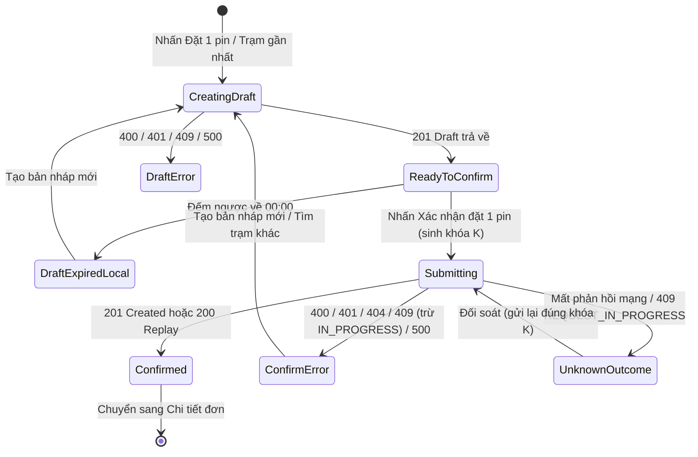

# Vinergy — Thiết kế giao diện Xác nhận đặt pin, Quản lý đơn & Hủy đơn (WBS 2.1.2)

> **Trạng thái:** Draft v1.0 (Sprint 2, Task 2.1.2 — D16–D18, 17–19/11/2026)  
> **Phụ trách:** M3 (Phạm Đức Trí) | **Rà soát đề xuất:** M1, M2, M5, M7  
> **Tham chiếu:** [SRS.md](../requirements/SRS.md) (§3, §4, §5 UC-02/UC-03, §7, §8), [Product_Backlog.md](../requirements/Product_Backlog.md) (US-201…US-204, US-304), [Acceptance_Examples_and_Sample_Data.md](../requirements/Acceptance_Examples_and_Sample_Data.md) (AE-08…AE-18, AE-21, AE-23), [api_contracts.md](../architecture/api_contracts.md) (§2, §3, §4.2, §6), [Database_Design.md](./Database_Design.md)  
> **Nguyên mẫu tương tác đi kèm:** [`prototypes/reservation-flow/`](../../prototypes/reservation-flow/) (Vite + React + Tailwind v4, dùng chung design tokens với [`prototypes/station-search/`](../../prototypes/station-search/)).

---

## 1. Hợp đồng thiết kế (Design Contract)

Thiết kế tuân thủ ngôn ngữ hình ảnh đã thiết lập ở WBS 1.2.1 (`prototypes/station-search/src/index.css`) và các tiêu chuẩn từ `frontend-ui-engineering` & `accessibility-engineering` (WCAG 2.2 AA).

| Hạng mục | Quy định |
| --- | --- |
| **Nhiệm vụ màn hình** | (1) Xác nhận rõ ràng bản nháp đặt **đúng 1 pin** (chưa giữ tồn kho trước khi xác nhận); (2) Xem danh sách & chi tiết đơn thuộc phiên hiện tại; (3) Hủy đơn `ACTIVE` an toàn và phản ánh đúng trạng thái `CANCELLED` / `EXPIRED` từ máy chủ; (4) Xử lý minh bạch mọi lỗi tồn kho, bản nháp, idempotency, phiên và mạng. |
| **Hành động chính** | `Xác nhận đặt 1 pin` (trong hộp thoại bản nháp), `Hủy đơn` (trong chi tiết đơn `ACTIVE`), `Đối soát kết quả` (khi mất phản hồi mạng). |
| **Hệ màu ngữ nghĩa** | Kế thừa nguyên vẹn `index.css`: `swap` (emerald `#059669`) cho đổi pin / trạng thái `ACTIVE`, `charge` (cyan `#0284c7`) cho sạc (chỉ tham khảo), `warn` (amber `#d97706`) cho hết pin / bản nháp sắp hết hạn / chưa rõ kết quả, `stop` (crimson `#dc2626`) cho lỗi / hủy đơn, `slate` cho bề mặt và trạng thái kết thúc (`CANCELLED`, `EXPIRED`). Không bao giờ dùng màu làm tín hiệu duy nhất — luôn đi kèm biểu tượng và nhãn văn bản. |
| **Chữ số & thời gian** | Mọi mã trạm, mã đơn, số lượng pin, khoảng cách và đồng hồ đếm ngược dùng lớp `.num` (`font-variant-numeric: tabular-nums`, monospace) để không rung giật khi đếm giây. |
| **Mẫu bị từ chối** | Không cho chọn số lượng khác `1` (BR-05); không ẩn thời hạn bản nháp/đơn; không hiển thị nút đặt pin cho trạm chỉ sạc (BR-02); không tự tạo khóa `Idempotency-Key` mới khi retry lỗi mạng (BR-08); không giả định thao tác mất phản hồi là thất bại hay thành công (FR-12); không dùng gradient/shadow nặng kiểu trang trí. |
| **Thông báo mô phỏng** | Luôn hiển thị thông báo bắt buộc (BR-01): **“Dữ liệu mô phỏng — việc đặt pin không có hiệu lực tại các trạm thực tế.”** |

> **Lưu ý về cấu hình thời lượng (SRS §8 / API v2.2 §6.3):** Thời lượng hiệu lực bản nháp (`DRAFT_TTL_MINUTES`) và thời lượng giữ pin (`RESERVATION_HOLD_MINUTES`) do máy chủ cấu hình. UI đọc trực tiếp `draft.hold_minutes` và `draft.expires_at` từ phản hồi máy chủ (không mặc định 15 phút ở phía client). Trong nguyên mẫu `prototypes/reservation-flow/`, thanh tiêu đề có bộ chọn `Giữ pin` (`10p`/`15p`/`25p`/`30p`) và đồng hồ máy chủ mô phỏng để kiểm chứng với cấu hình khác 15 phút.

---

## 2. Luồng tương tác & Chuyển trạng thái

### 2.1. Luồng tổng thể: Chuẩn bị bản nháp → Xác nhận → Xem / Hủy / Hết hạn

```mermaid
flowchart TD
    Start["Chọn trạm đổi pin đủ điều kiện<br/>(từ DetailDrawer 1.2.1 hoặc 'Trạm gần nhất')"] --> CreateDraft["POST /api/v1/reservation-drafts<br/>{ station_id | nearest, family_code, quantity: 1 }"]
    CreateDraft -->|401 SESSION_REQUIRED/EXPIRED| AuthPrompt["Nhắc chọn / khôi phục phiên demo"]
    CreateDraft -->|409 NO_ELIGIBLE_STATION / STATION_NOT_ELIGIBLE| DraftReject["Hiển thị lý do không khả dụng<br/>(0 tồn kho bị thay đổi)"]
    CreateDraft -->|201 DraftCreated| ConfirmUI["Màn hình Xác nhận bản nháp<br/>• Trạm, khu vực, khoảng cách<br/>• Nhóm pin (FAM_A/FAM_B)<br/>• Số lượng cố định: 1 pin<br/>• Hạn bản nháp (đếm ngược)<br/>• Nhãn: Bản nháp chưa giữ tồn kho"]

    ConfirmUI -->|Đóng / Quay lại| Abandon["Bỏ bản nháp<br/>(tồn kho không đổi — AE-09)"]
    ConfirmUI -->|Nhấn 'Xác nhận đặt 1 pin'| ConfirmReq["POST /api/v1/reservations<br/>Header: Idempotency-Key = K (UUID)<br/>{ draft_id, station_id, family_code, quantity: 1 }"]

    ConfirmReq -->|201 Created / 200 Idempotent-Replayed| OrderDetail["Màn hình Chi tiết đơn (ACTIVE)<br/>• reservation_id, trạng thái ACTIVE<br/>• Hạn giữ pin (expires_at)<br/>• Tồn kho trạm giảm đúng 1"]
    ConfirmReq -->|409 STATION_NOT_ELIGIBLE| StockErr["Lỗi tồn kho/trạng thái lúc xác nhận<br/>• Gợi ý chọn trạm gần nhất khác"]
    ConfirmReq -->|409 DRAFT_STALE / DRAFT_ALREADY_USED| DraftErr["Bản nháp hết hạn / đã dùng<br/>• Nút 'Tạo bản nháp mới'"]
    ConfirmReq -->|409 IDEMPOTENCY_KEY_REUSED| KeyErr["Xung đột khóa chống lặp<br/>• Yêu cầu tạo bản nháp & khóa mới"]
    ConfirmReq -->|409 REQUEST_IN_PROGRESS hoặc Mất phản hồi mạng| UnknownUI["Trạng thái CHƯA RÕ KẾT QUẢ (FR-12)<br/>• Giữ nguyên khóa K<br/>• Nút 'Đối soát bằng khóa cũ'<br/>• Nút 'Kiểm tra Đơn của tôi'"]
    UnknownUI -->|Gửi lại cùng khóa K| ConfirmReq

    OrderDetail -->|Hủy đơn trước expires_at| CancelDlg["Hộp thoại Xác nhận hủy"]
    CancelDlg -->|Xác nhận hủy| CancelReq["POST /api/v1/reservations/:id/cancel"]
    CancelReq -->|200 CANCELLED| CancelledState["Trạng thái CANCELLED<br/>Hoàn pin đúng 1 lần (AE-15)"]
    CancelReq -->|200 EXPIRED (BR-09)| ExpiredState["Trạng thái EXPIRED<br/>Đơn đã quá hạn trước khi hủy (AE-16b)"]
    OrderDetail -->|server_time >= expires_at & làm mới| ExpiredState
```

### 2.2. Máy trạng thái màn hình Xác nhận bản nháp



---

## 3. Wireframe các màn hình chính

### 3.1. Màn hình A — Hộp thoại Xác nhận đặt pin (`ConfirmDraftModal`)

Hiển thị dạng modal dialog ở giữa màn hình trên desktop (`max-w-lg`) và bottom-sheet/full-width dialog trên mobile (`320px+`). Tập trung tối đa vào 4 thông tin bắt buộc trước khi xác nhận: **trạm, nhóm pin, số lượng (`1`) và thời hạn**.

```text
+-----------------------------------------------------------------------+
|  XÁC NHẬN ĐẶT PIN                                              [ X ]  |
|  Dữ liệu mô phỏng — việc đặt pin không có hiệu lực tại trạm thực tế.  |
+-----------------------------------------------------------------------+
|  [i] Bản nháp chưa giữ tồn kho. Pin chỉ được giữ khi bạn nhấn         |
|      "Xác nhận đặt 1 pin".                                            |
+-----------------------------------------------------------------------+
|  TRẠM ĐỔI PIN                                                         |
|  ST-01 · Vinergy Demo Station 01                         [ Đang mở ]  |
|  Hai Ba Trung demo area · 0.0 km đường thẳng                          |
|  Tồn kho hiện tại (FAM_A): 6 pin khả dụng                             |
+-----------------------------------------------------------------------+
|  NHÓM PIN                |  SỐ LƯỢNG (BR-05)                          |
|  FAM_A                   |  1 pin (cố định)                           |
|  Fictional family A      |  Chỉ cho phép đặt đúng 1 pin mỗi đơn       |
+-----------------------------------------------------------------------+
|  THỜI HẠN BẢN NHÁP (BR-06)                    HẠN GIỮ PIN DỰ KIẾN     |
|  Còn 04:52 (hết hạn lúc 18:35:00 UTC)         Tính từ lúc máy chủ     |
|  [=============-------]                       xác nhận thành công     |
+-----------------------------------------------------------------------+
|  Mã bản nháp (UUID): 9a7e3c52-1f4b-4d8a-b6c2-0e5f7a9b1d34 · Phiên: USER-A |
|  Khóa chống lặp (Idempotency-Key): 8b2f6c1a-3d4e-4f5a-9b6c-7d8e9f0a1b2c  |
+-----------------------------------------------------------------------+
|  [ Quay lại ]                              [ Xác nhận đặt 1 pin ]     |
+-----------------------------------------------------------------------+
```

**Hành vi bắt buộc trên Màn hình A:**
- Trường `quantity` hiển thị rõ là **`1 pin`** ở dạng chỉ đọc (không có stepper `+`/`-` để tránh vi phạm BR-05; nếu gọi API bằng dữ liệu sai ở tầng kiểm thử, lỗi `400 INVALID_INPUT` vẫn được render rõ).
- Khi đồng hồ đếm ngược bản nháp về `00:00`, hiển thị cảnh báo `warn`: *"Bản nháp đã hết hiệu lực theo đồng hồ. Nhấn 'Tạo bản nháp mới' để kiểm tra lại tồn kho."* và vô hiệu hóa nút xác nhận.
- Nhấn `Xác nhận đặt 1 pin` khóa nút (hiện spinner + *"Đang xác nhận nguyên tử…"*), giữ nguyên `Idempotency-Key` trong suốt vòng đời lần xác nhận đó.

### 3.2. Màn hình B — Đơn của tôi & Chi tiết đơn (`OrderList` + `OrderDetailPanel`)

Bố cục 2 cột trên desktop (`>= 1024px`: danh sách bên trái `380px`, chi tiết bên phải) và xếp dọc / chuyển chi tiết trên mobile (`320px–768px`).

```text
+---------------------------------------------------------------------------------------+
|  VIBERGY / VINERGY   [ Tìm trạm ]  [ Đơn của tôi (1) ]       Phiên: [ USER-A v ]      |
|  [i] Dữ liệu mô phỏng — việc đặt pin không có hiệu lực tại các trạm thực tế.          |
+---------------------------------------------------------------------------------------+
|  ĐƠN CỦA TÔI (USER-A)                  |  CHI TIẾT ĐƠN · res_01JCXZ...                |
|  [ Tất cả (3) ] [ Đang giữ (1) ]       |  +-----------------------------------------+ |
|  [ Đã hủy (1) ] [ Hết hạn (1) ]        |  | [● ĐANG GIỮ PIN (ACTIVE)]               | |
|                                        |  | Hết hạn sau: 14:28 (18:45:00 UTC)       | |
|  +----------------------------------+  |  | [==================-----]               | |
|  | res_01JCXZ...      [ Đang giữ ]  |  |  +-----------------------------------------+ |
|  | ST-01 · Station 01               |  |                                              |
|  | FAM_A · 1 pin · Còn 14:28        |  |  Trạm đổi pin: ST-01 · Vinergy Demo 01       |
|  +----------------------------------+  |  Khu vực:      Hai Ba Trung demo area        |
|                                        |  Nhóm pin:     FAM_A (Fictional family A)    |
|  +----------------------------------+  |  Số lượng:     1 pin                         |
|  | res_01J9AB...       [ Đã hủy ]   |  |  Chủ sở hữu:   USER-A (từ phiên máy chủ)     |
|  | ST-03 · Station 03               |  |  Tạo lúc:      2026-11-25T18:30:00Z          |
|  | FAM_A · 1 pin · Hủy lúc 18:12    |  |  Hết hạn lúc:  2026-11-25T18:45:00Z          |
|  +----------------------------------+  |                                              |
|                                        |  [ Làm mới từ máy chủ ] [ Chỉ đường (Maps) ] |
|  +----------------------------------+  |  [ Hủy đơn này ]  (chỉ hiện khi ACTIVE)      |
|  | res_01J8XY...       [ Hết hạn ]  |  +----------------------------------------------+
|  | ST-06 · Station 06               |
|  | FAM_A · 1 pin · Quá hạn 17:50    |
|  +----------------------------------+
+---------------------------------------------------------------------------------------+
```

**Hành vi bắt buộc trên Màn hình B:**
- Chỉ hiển thị đơn thuộc phiên hiện tại (`USER-A` hoặc `USER-B`). Khi đổi sang `USER-B`, danh sách được tải lại theo phiên mới; thử truy cập mã đơn của `USER-A` trả `404 RESERVATION_NOT_FOUND` (không lộ dữ liệu, AE-14).
- Nếu đơn `ACTIVE` đã vượt quá `expires_at`, thao tác tải danh sách / làm mới / hủy sẽ đối soát phía máy chủ và cập nhật giao diện sang `EXPIRED` (BR-09).
- Nút `Chỉ đường (Maps)` mở Google Maps URL với tọa độ `coordinates` của trạm, không cam kết thời gian di chuyển (FR-04).
- Khi danh sách trống: hiển thị empty state rõ ràng (*"Chưa có đơn đặt pin nào trong phiên USER-A"*) kèm nút tạo bản nháp mới, tách biệt hoàn toàn với trạng thái lỗi API.

### 3.3. Màn hình C — Hộp thoại Xác nhận hủy đơn (`CancelOrderDialog`)

```text
+-----------------------------------------------------------------------+
|  HỦY ĐƠN ĐẶT PIN?                                              [ X ]  |
+-----------------------------------------------------------------------+
|  Bạn sắp hủy lượt giữ 1 pin FAM_A tại ST-01 · Vinergy Demo Station 01 |
|  (Mã đơn: res_01JCXZ...).                                             |
|                                                                       |
|  • Thao tác này không thể hoàn tác.                                   |
|  • 1 pin sẽ được hoàn lại tồn kho khả dụng của trạm đúng một lần      |
|    (nếu đơn chưa hết hạn tại thời điểm máy chủ xử lý).                |
+-----------------------------------------------------------------------+
|  [ Giữ lại đơn ]                                [ Xác nhận hủy đơn ]  |
+-----------------------------------------------------------------------+
```

**Phản hồi sau khi hủy (BR-09, AE-15, AE-16):**
- Nếu máy chủ trả `status: "CANCELLED"`: hiện banner thông báo *"Đã hủy đơn và hoàn lại 1 pin FAM_A vào tồn kho ST-01."* và làm mới tồn kho trạm.
- Nếu máy chủ trả `status: "EXPIRED"` (do đơn hết hạn ngay trước/tại thời điểm hủy — AE-16b): hiện banner cảnh báo `warn` *"Đơn đã hết hạn theo giờ máy chủ trước khi hủy. Trạng thái được cập nhật thành Hết hạn và pin đã được hoàn lại đúng một lần."* — **không** báo hủy thành công sai lệch.

---

## 4. Ma trận xử lý lỗi tồn kho, bản nháp, idempotency & API

Mỗi lỗi từ `api_contracts.md §2.2 & §6.2` có thông điệp người dùng rõ nguyên nhân và hành động khôi phục cụ thể (không hiển thị mã lỗi kỹ thuật thô thay cho giải thích, không tạo đơn trùng).

| HTTP / Nguồn | `error.code` / `reason` | Thông điệp hiển thị cho người dùng | Hành động khôi phục trên UI | AE liên quan |
| --- | --- | --- | --- | --- |
| `400` | `INVALID_INPUT` (gồm `quantity ≠ 1`) | "Thông tin đặt pin chưa hợp lệ." + danh sách lỗi từng trường (`details`) | Giữ nguyên trường hợp lệ, đưa focus về trường lỗi | AE-08 |
| `401` | `SESSION_REQUIRED` / `SESSION_EXPIRED` | "Phiên demo đã hết hạn hoặc chưa được chọn. Vui lòng chọn lại người dùng demo để tiếp tục." | Nút `Khôi phục phiên demo` (chọn `USER-A`/`USER-B`); không lộ dữ liệu đơn cũ | AE-23f |
| `403` | `CSRF_INVALID` | "Mã bảo vệ phiên không hợp lệ. Vui lòng làm mới phiên và thử lại." | Nút `Làm mới phiên` (`GET /api/v1/demo-session`) | NFR-03 |
| `404` | `DRAFT_NOT_FOUND` | "Không tìm thấy bản nháp đặt pin trong phiên hiện tại." | Nút `Tạo bản nháp mới` | AE-17 |
| `404` | `RESERVATION_NOT_FOUND` | "Không tìm thấy đơn đặt pin trong phiên hiện tại." (không tiết lộ đơn thuộc người khác) | Nút `Quay về Đơn của tôi` | AE-14 |
| `409` | `STATION_NOT_ELIGIBLE` · `OUT_OF_STOCK` | "Viên pin cuối cùng tại trạm này vừa được giữ trước khi bạn xác nhận. Chưa có đơn nào được tạo." | Nút `Tìm trạm gần nhất còn pin` (AE-18) / `Quay lại danh sách` | AE-10, AE-13 |
| `409` | `STATION_NOT_ELIGIBLE` · `STATION_CLOSED` / `STATION_MAINTENANCE` / `CHARGING_ONLY` / `UNSUPPORTED_FAMILY` | Hiển thị đúng lý do từ `INELIGIBILITY_TEXT` (VD: *"Trạm đang đóng cửa"*, *"Chỉ có cổng sạc — không hỗ trợ đặt trước"*) | Nút `Tìm trạm gần nhất còn pin` | AE-02, AE-03, AE-10 |
| `409` | `NO_ELIGIBLE_STATION` | "Không có trạm đổi pin nào đang mở, tương thích và còn pin trong phạm vi hiện tại. Không tạo bản nháp." | Nút `Mở rộng bán kính` hoặc `Chọn trạm thủ công` (không tự mở rộng ngầm) | AE-18 |
| `409` | `DRAFT_STALE` (`DRAFT_EXPIRED` / `CONTENT_MISMATCH`) | "Bản nháp đã hết hiệu lực hoặc nội dung xác nhận không khớp với bản nháp. Vui lòng tạo bản nháp mới để kiểm tra lại tồn kho." | Nút `Tạo bản nháp mới` (sinh `draft_id` và `Idempotency-Key` mới) | AE-17 |
| `409` | `DRAFT_ALREADY_USED` | "Bản nháp này đã được xác nhận tạo đơn trước đó." | Nút `Xem Đơn của tôi` + nút `Tạo bản nháp mới` (nếu muốn đặt đơn khác) | AE-17 |
| `409` | `IDEMPOTENCY_KEY_REUSED` | "Khóa chống xử lý lặp đã được dùng cho một yêu cầu khác. Chưa có đơn mới nào được tạo." | Nút `Tạo bản nháp mới` (cấp khóa mới sạch) | AE-12 |
| `409` | `REQUEST_IN_PROGRESS` | "Yêu cầu xác nhận cùng khóa đang được máy chủ xử lý. Vui lòng đối soát lại sau giây lát." | Nút `Đối soát bằng khóa cũ` (giữ nguyên `Idempotency-Key`, tôn trọng `Retry-After`) | AE-11 |
| `500` / Mạng | `INTERNAL_ERROR` / Network timeout khi **xác nhận** | "**Chưa rõ kết quả xác nhận.** Yêu cầu có thể đã được máy chủ ghi nhận trước khi mất kết nối. Không tự tạo đơn mới." | (1) `Đối soát bằng khóa cũ` (gửi lại đúng `Idempotency-Key` cũ → nhận `200 Idempotent-Replayed` nếu đã thành công); (2) `Kiểm tra Đơn của tôi` | FR-12, AE-11, AE-21 |
| `500` / Mạng | `INTERNAL_ERROR` / Network timeout khi **đọc/tạo nháp** | "Dịch vụ tạm thời gặp sự cố. Không có tồn kho nào bị thay đổi." | Nút `Thử lại` (không hiển thị như danh sách rỗng) | FR-12, NFR-02 |

---

## 5. Ma trận Responsive & Khả năng truy cập (SRS §8 / NFR-05 / AE-23d, AE-23e)

Đóng phần mở rộng kích thước hiển thị và kiểm tra bàn phím cho luồng đặt pin (mốc WBS 2.1.2 trong SRS §8):

### 5.1. Ma trận kích thước hiển thị

| Breakpoint | Bố cục Màn hình Xác nhận | Bố cục Đơn của tôi & Chi tiết | Mục tiêu chạm & đọc |
| --- | --- | --- | --- |
| `320px` (Mobile nhỏ) | Dialog full-width (`mx-2`), lưới thông tin 1 cột, 2 nút xếp dọc (`flex-col-reverse`), nhãn mô phỏng không bị cắt | 1 cột: danh sách đơn phía trên hoặc chuyển sang khung chi tiết có nút `Quay lại danh sách` | Không tràn ngang (`overflow-x: hidden`), nút tối thiểu `44×44 px`, cỡ chữ tối thiểu `12px` |
| `768px` (Tablet) | Dialog căn giữa `max-w-lg`, lưới nhóm pin & số lượng 2 cột | 2 cột gọn (`grid-cols-12`: 5/7) | Thanh trạng thái phiên và bộ lọc tab nằm gọn 1–2 dòng |
| `1024px` (Laptop) | Dialog căn giữa `max-w-lg` | 2 cột (`380px` danh sách cuộn độc lập + chi tiết bên phải) | Toàn bộ thông tin chính của đơn thấy ngay không cần cuộn |
| `1440px` (Desktop) | Dialog căn giữa `max-w-lg` trong vùng nội dung `max-w-6xl` | 2 cột rộng thoáng, hiển thị đủ lịch sử đơn và bảng đối chiếu tồn kho | Độ rộng dòng văn bản tối đa `65ch` |

### 5.2. Checklist bàn phím & WCAG 2.2 AA

- **Dialog (`ConfirmDraftModal`, `CancelOrderDialog`)**: dùng `role="dialog"`, `aria-modal="true"`, `aria-labelledby`, `aria-describedby`; tự động chuyển focus vào trong dialog khi mở, giữ vòng lặp `Tab`/`Shift+Tab` bên trong dialog, đóng bằng phím `Escape` (trừ khi đang gửi yêu cầu xác nhận nguyên tử để tránh đóng nhầm giữa chừng), và trả focus về nút kích hoạt khi đóng.
- **Thông báo động**: Banner lỗi dùng `role="alert"` (`aria-live="assertive"`); cập nhật số lượng đơn, trạng thái đếm ngược ở mốc cảnh báo và kết quả làm mới dùng `role="status"` (`aria-live="polite"`).
- **Điều khiển bàn phím**: Mọi thao tác chọn trạm, tạo bản nháp, xác nhận, đổi tab lọc đơn, chọn đơn, làm mới, hủy đơn và đổi phiên demo đều dùng thẻ `<button>` / `<select>` / `<input>` chuẩn, có vòng `:focus-visible` độ tương phản cao (`2px solid slate-900`).
- **Tương phản & Chuyển động**: Tỷ lệ tương phản văn bản `>= 4.5:1` (`slate-900`/`slate-700` trên nền trắng/slate-50, `swap-700` trên `swap-50`, `stop-700` trên `stop-50`); toàn bộ animation tắt khi `prefers-reduced-motion: reduce`.

---

## 6. Truy vết yêu cầu & Nghiệm thu

| Yêu cầu / AE | Thành phần / Hành vi đáp ứng trong 2.1.2 |
| --- | --- |
| FR-06, BR-05, BR-06, AE-08, AE-09 | `ConfirmDraftModal` khóa `quantity = 1`, hiển thị trạm/nhóm pin/hạn bản nháp và nhãn "Bản nháp chưa giữ tồn kho"; tồn kho chỉ giảm khi xác nhận. |
| FR-06, BR-07, AE-10, AE-13 | `confirmReservation()` kiểm tra nguyên tử; khi hết pin lúc xác nhận trả `409 STATION_NOT_ELIGIBLE (OUT_OF_STOCK)` và gợi ý trạm gần nhất đủ điều kiện. |
| FR-07, FR-12, BR-08, AE-11, AE-12, AE-21 | Trạng thái "Chưa rõ kết quả" giữ nguyên `Idempotency-Key` để đối soát (`200 Idempotent-Replayed`); đổi nội dung cùng khóa hiển thị `409 IDEMPOTENCY_KEY_REUSED`. |
| FR-07, FR-08, BR-10, AE-14, AE-23f | Bộ chuyển phiên demo (`USER-A`/`USER-B`); đơn của người khác trả `404 RESERVATION_NOT_FOUND`; phiên hết hạn trả `401 SESSION_EXPIRED`. |
| FR-08, FR-09, BR-09, AE-15, AE-16 | `CancelOrderDialog` + đồng hồ máy chủ mô phỏng; hủy trước hạn → `CANCELLED` (+1 tồn kho đúng 1 lần); hủy tại/sau hạn → đối soát `EXPIRED` (+1 tồn kho đúng 1 lần). |
| BR-06, AE-17 | Xử lý riêng `DRAFT_STALE` (hết hạn/đổi revision) và `DRAFT_ALREADY_USED` (đã tạo đơn với khóa khác). |
| FR-11, AE-18 | Nút "Đặt tại trạm gần nhất đủ điều kiện" bỏ qua ST-05 hết pin để chọn ST-03 (1.2 km), hoặc trả `NO_ELIGIBLE_STATION` khi bán kính `0.5 km`. |
| BR-01, NFR-05, AE-23d, AE-23e | Nhãn dữ liệu mô phỏng cố định, điều hướng bàn phím đầy đủ, kiểm thử 4 breakpoint `320/768/1024/1440px`. |
