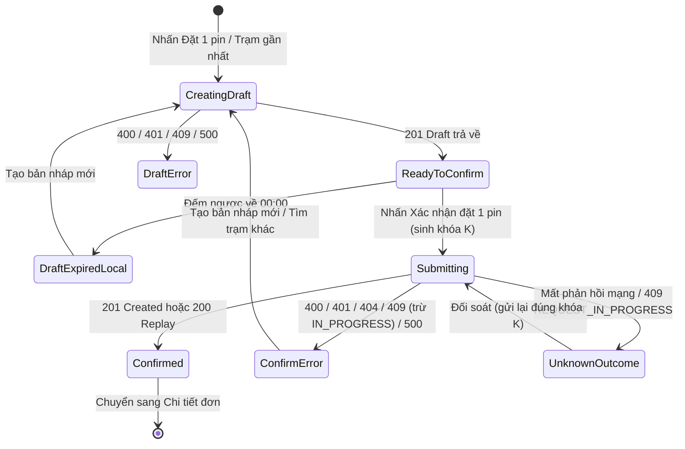

# Vinergy — Thiết kế giao diện Xác nhận đặt pin, Quản lý đơn & Hủy đơn (WBS 2.1.2)

> **Trạng thái:** Draft v1.0 (Sprint 2, Task 2.1.2 — D16–D18, 17–19/11/2026)  
> **Phụ trách:** M3 (Phạm Đức Trí) | **Rà soát đề xuất:** M1, M2, M5, M7  
> **Tham chiếu:** [SRS.md](../requirements/SRS.md) (§3, §4, §5 UC-02/UC-03, §7, §8), [Product_Backlog.md](../requirements/Product_Backlog.md) (US-201…US-204, US-304), [Acceptance_Examples_and_Sample_Data.md](../requirements/Acceptance_Examples_and_Sample_Data.md) (AE-08…AE-18, AE-21, AE-23), [api_contracts.md](../architecture/api_contracts.md) (§2, §3, §4.2, §6), [Database_Design.md](./Database_Design.md)  
> **Nguyên mẫu tương tác đi kèm:** [`prototypes/reservation-flow/`](../../prototypes/reservation-flow/) (Vite + React + Tailwind v4, dùng chung design tokens với [`prototypes/station-search/`](../../prototypes/station-search/)).

---

## 1. Hợp đồng thiết kế (Design Contract)

Thiết kế tuân thủ ngôn ngữ hình ảnh đã thiết lập ở WBS 1.2.1 (`prototypes/station-search/src/index.css`) và các tiêu chuẩn từ `frontend-ui-engineering` & `accessibility-engineering` (WCAG 2.2 AA).

| Hạng mục | Quy định |
| --- | --- |
| **Nhiệm vụ màn hình** | (1) Xác nhận rõ ràng bản nháp đặt **đúng 1 pin** (chưa giữ tồn kho trước khi xác nhận); (2) Xem danh sách & chi tiết đơn thuộc phiên hiện tại; (3) Hủy đơn `ACTIVE` an toàn và phản ánh đúng trạng thái `CANCELLED` / `EXPIRED` từ máy chủ; (4) Xử lý minh bạch mọi lỗi tồn kho, bản nháp, idempotency, phiên và mạng. |
| **Hành động chính** | `Xác nhận đặt 1 pin` (trong hộp thoại bản nháp), `Hủy đơn` (trong chi tiết đơn `ACTIVE`), `Đối soát kết quả` (khi mất phản hồi mạng). |
| **Hệ màu ngữ nghĩa** | Kế thừa nguyên vẹn `index.css`: `swap` (emerald `#059669`) cho đổi pin / trạng thái `ACTIVE`, `charge` (cyan `#0284c7`) cho sạc (chỉ tham khảo), `warn` (amber `#d97706`) cho hết pin / bản nháp sắp hết hạn / chưa rõ kết quả, `stop` (crimson `#dc2626`) cho lỗi / hủy đơn, `slate` cho bề mặt và trạng thái kết thúc (`CANCELLED`, `EXPIRED`). Không bao giờ dùng màu làm tín hiệu duy nhất — luôn đi kèm biểu tượng và nhãn văn bản. |
| **Chữ số & thời gian** | Mọi mã trạm, mã đơn, số lượng pin, khoảng cách và đồng hồ đếm ngược dùng lớp `.num` (`font-variant-numeric: tabular-nums`, monospace) để không rung giật khi đếm giây. |
| **Mẫu bị từ chối** | Không cho chọn số lượng khác `1` (BR-05); không ẩn thời hạn bản nháp/đơn; không hiển thị nút đặt pin cho trạm chỉ sạc (BR-02); không tự tạo khóa `Idempotency-Key` mới khi retry lỗi mạng (BR-08); không giả định thao tác mất phản hồi là thất bại hay thành công (FR-12); không dùng gradient/shadow nặng kiểu trang trí. |
| **Thông báo mô phỏng** | Luôn hiển thị thông báo bắt buộc (BR-01): **“Dữ liệu mô phỏng — việc đặt pin không có hiệu lực tại các trạm thực tế.”** |

> **Lưu ý về cấu hình thời lượng (SRS §8 / API v2.2 §6.3):** Thời lượng hiệu lực bản nháp (`DRAFT_TTL_MINUTES`) và thời lượng giữ pin (`RESERVATION_HOLD_MINUTES`) do máy chủ cấu hình. UI đọc trực tiếp `draft.hold_minutes` và `draft.expires_at` từ phản hồi máy chủ (không mặc định 15 phút ở phía client). Trong nguyên mẫu `prototypes/reservation-flow/`, thanh tiêu đề có bộ chọn `Giữ pin` (`10p`/`15p`/`25p`/`30p`) và đồng hồ máy chủ mô phỏng để kiểm chứng với cấu hình khác 15 phút.

---

## 2. Luồng tương tác & Chuyển trạng thái

### 2.1. Luồng tổng thể: Chuẩn bị bản nháp → Xác nhận → Xem / Hủy / Hết hạn

```mermaid
flowchart TD
    Start["Chọn trạm đổi pin đủ điều kiện<br/>(từ DetailDrawer 1.2.1 hoặc 'Trạm gần nhất')"] --> CreateDraft["POST /api/v1/reservation-drafts<br/>{ station_id | nearest, family_code, quantity: 1 }"]
    CreateDraft -->|401 SESSION_REQUIRED/EXPIRED| AuthPrompt["Nhắc chọn / khôi phục phiên demo"]
    CreateDraft -->|409 NO_ELIGIBLE_STATION / STATION_NOT_ELIGIBLE| DraftReject["Hiển thị lý do không khả dụng<br/>(0 tồn kho bị thay đổi)"]
    CreateDraft -->|201 DraftCreated| ConfirmUI["Màn hình Xác nhận bản nháp<br/>• Trạm, khu vực, khoảng cách<br/>• Nhóm pin (FAM_A/FAM_B)<br/>• Số lượng cố định: 1 pin<br/>• Hạn bản nháp (đếm ngược)<br/>• Nhãn: Bản nháp chưa giữ tồn kho"]

    ConfirmUI -->|Đóng / Quay lại| Abandon["Bỏ bản nháp<br/>(tồn kho không đổi — AE-09)"]
    ConfirmUI -->|Nhấn 'Xác nhận đặt 1 pin'| ConfirmReq["POST /api/v1/reservations<br/>Header: Idempotency-Key = K (UUID)<br/>{ draft_id, station_id, family_code, quantity: 1 }"]

    ConfirmReq -->|201 Created / 200 Idempotent-Replayed| OrderDetail["Màn hình Chi tiết đơn (ACTIVE)<br/>• reservation_id, trạng thái ACTIVE<br/>• Hạn giữ pin (expires_at)<br/>• Tồn kho trạm giảm đúng 1"]
    ConfirmReq -->|409 STATION_NOT_ELIGIBLE| StockErr["Lỗi tồn kho/trạng thái lúc xác nhận<br/>• Gợi ý chọn trạm gần nhất khác"]
    ConfirmReq -->|409 DRAFT_STALE / DRAFT_ALREADY_USED| DraftErr["Bản nháp hết hạn / đã dùng<br/>• Nút 'Tạo bản nháp mới'"]
    ConfirmReq -->|409 IDEMPOTENCY_KEY_REUSED| KeyErr["Xung đột khóa chống lặp<br/>• Yêu cầu tạo bản nháp & khóa mới"]
    ConfirmReq -->|409 REQUEST_IN_PROGRESS hoặc Mất phản hồi mạng| UnknownUI["Trạng thái CHƯA RÕ KẾT QUẢ (FR-12)<br/>• Giữ nguyên khóa K<br/>• Nút 'Đối soát bằng khóa cũ'<br/>• Nút 'Kiểm tra Đơn của tôi'"]
    UnknownUI -->|Gửi lại cùng khóa K| ConfirmReq

    OrderDetail -->|Hủy đơn trước expires_at| CancelDlg["Hộp thoại Xác nhận hủy"]
    CancelDlg -->|Xác nhận hủy| CancelReq["POST /api/v1/reservations/:id/cancel"]
    CancelReq -->|200 CANCELLED| CancelledState["Trạng thái CANCELLED<br/>Hoàn pin đúng 1 lần (AE-15)"]
    CancelReq -->|200 EXPIRED (BR-09)| ExpiredState["Trạng thái EXPIRED<br/>Đơn đã quá hạn trước khi hủy (AE-16b)"]
    OrderDetail -->|server_time >= expires_at & làm mới| ExpiredState
```

### 2.2. Máy trạng thái màn hình Xác nhận bản nháp



---

