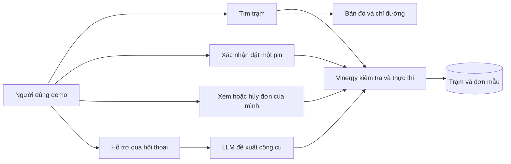
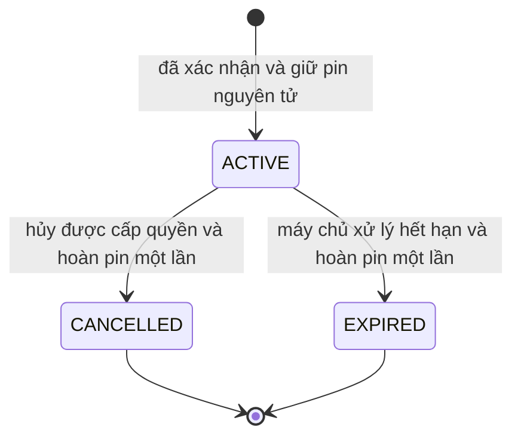

# Đặc tả yêu cầu phần mềm Vinergy

Phiên bản 0.2. Cập nhật ngày 2 tháng 11 năm 2026. **Bản nháp — đang chờ nhóm rà soát.** Người phụ trách: M1; người rà soát đề xuất: M2, M4 và M7. Tài liệu mô tả hành vi mong đợi; không khẳng định các tính năng đã được triển khai, kiểm thử đã đạt hoặc việc rà soát đã hoàn tất.

## 1. Mục đích, phạm vi và cơ sở yêu cầu

Vinergy là bản trình diễn ứng dụng web phục vụ đồ án, dùng để tìm trạm sạc/đổi pin và đặt giữ **đúng một pin** tại trạm đổi pin đủ điều kiện. Ứng dụng sử dụng 18 bản ghi trạm giả lập tại khu vực Hà Nội, hai nhóm xe/pin giả lập, Google Maps và chatbot có phạm vi hoạt động giới hạn.

Đây là tài liệu yêu cầu chính cho nhiệm vụ **1.1.1, D1–D3, ngày 2–4 tháng 11 năm 2026**. Tài liệu liên quan: [Danh sách yêu cầu sản phẩm](Product_Backlog.md) và [Ví dụ nghiệm thu và dữ liệu mẫu](Acceptance_Examples_and_Sample_Data.md). Nguồn lịch thực hiện: [kế hoạch tổng](../../../Vinergy_Project_Plan.xlsx) và [kế hoạch sprint chi tiết](../../../Vinergy_Detail_Plan.xlsx).

| Phần sản phẩm bàn giao | Khoảng thời gian cố định | Kết quả bắt buộc |
| --- | --- | --- |
| Sprint 1, W10–11 | 2–15/11/2026 | Tìm kiếm/danh sách/bản đồ, yêu cầu/thiết kế/dữ liệu, thử nghiệm kỹ thuật gọi công cụ bằng LLM |
| Sprint 2, W12–13 | 16–29/11/2026 | Đặt pin qua biểu mẫu, quyền sở hữu đơn, hủy/hết hạn, tính toàn vẹn tồn kho |
| Sprint 3, W14–15 | 30/11–13/12/2026 | Chatbot hoàn chỉnh trong phạm vi giới hạn, kiểm thử hồi quy, kiểm thử chấp nhận người dùng nội bộ, chốt phiên bản phát hành |
| W16 | Chỉ ngày 17/12/2026, D46 | Một buổi thuyết trình/hỏi đáp và chia sẻ tài liệu đã chuẩn bị |

Trong phạm vi: vị trí hiện tại/nhập thủ công, lọc theo dịch vụ/nhóm xe-pin/trạng thái, xếp hạng theo khoảng cách đường thẳng, danh sách/bản đồ/chi tiết/chỉ đường, vòng đời đặt pin giả lập, các công cụ dùng chung ở phía máy chủ và yêu cầu đặt lại bộ dữ liệu demo biệt lập. Thử nghiệm kỹ thuật ở Sprint 1 chưa phải chatbot hoàn chỉnh. Các chức năng Sprint 2/3 là bắt buộc, không phải phần mở rộng tùy chọn.

Ngoài phạm vi: đặt cổng sạc, thanh toán, giao dịch thực với đơn vị vận hành/quy trình quản trị, hoàn tất đổi pin hoặc trả pin ngoài thực tế, IoT/dữ liệu thiết bị trực tiếp, bảo đảm thành phần hóa học/điện áp/trạng thái sạc của pin, ứng dụng di động gốc và hỗ trợ mọi loại xe. Không cam kết dự đoán thời gian di chuyển/tình trạng giao thông. Không khẳng định mối liên kết với VinFast hoặc bất kỳ nhà sản xuất/đơn vị vận hành nào khác.

`FAM_A` và `FAM_B` là **hai nhóm giả lập trong bộ dữ liệu mẫu**, không tương thích với nhau; không phải thông số xe/đầu nối đã được xác minh. Tất cả tên trạm và tọa độ gần đúng chỉ mang tính minh họa, không phải địa điểm dịch vụ thực đã khảo sát. Hiển thị thông báo **“Dữ liệu mô phỏng — việc đặt pin không có hiệu lực tại các trạm thực tế.”**

## 2. Tác nhân và ranh giới hệ thống

- **Người dùng demo:** chọn vị trí/nhóm xe-pin, tìm trạm và quản lý đơn đặt pin trong phiên demo.
- **Chức năng định vị của trình duyệt:** cung cấp tọa độ khi được người dùng cho phép; vẫn hỗ trợ chọn vị trí thủ công.
- **Google Maps:** hiển thị bản đồ và mở chỉ đường bên ngoài; không quản lý tồn kho của Vinergy.
- **Nhà cung cấp LLM:** đề xuất các lệnh gọi công cụ trong phạm vi cho phép; Vinergy kiểm tra và thực thi.
- **Nhóm phát triển/kiểm thử:** duy trì bộ dữ liệu mẫu biệt lập, không thực hiện quy trình vận hành trạm ngoài thực tế. Giảng viên đánh giá bản demo cuối cùng; việc nghiệm thu đang chờ thực hiện.

Đây là sơ đồ ranh giới ở mức khái niệm, chưa phải kiến trúc hoàn chỉnh và không khẳng định tuân thủ một hệ ký pháp cụ thể trong bài giảng.

## 3. Quy tắc nghiệp vụ

| Mã | Quy tắc cơ sở |
| --- | --- |
| BR-01 | Gắn nhãn mô phỏng cho trạm, số lượng tài nguyên và đơn đặt pin. Chỉ hỗ trợ hai nhóm mẫu `FAM_A`/`FAM_B`. |
| BR-02 | `CHARGING` chỉ phục vụ tìm kiếm. Chỉ `SWAPPING` cho phép giữ pin. Trường `services` của trạm là mảng chứa các giá trị này; `BOTH` không phải giá trị liệt kê riêng. |
| BR-03 | Khả năng tương thích được xác định từ `supported_families`, không phụ thuộc tồn kho có lớn hơn không hay không. Trạm đang mở và tương thích nhưng hết pin vẫn xuất hiện trong kết quả, hiển thị “không còn pin” và không cho đặt. Trạm không hỗ trợ nhóm được chọn bị loại khỏi kết quả tìm kiếm đã lọc. |
| BR-04 | Dùng khoảng cách Haversine với bán kính Trái Đất 6371 km. Sắp xếp tăng dần theo khoảng cách chưa làm tròn, sau đó theo `station_id` khi bằng nhau. Hiển thị km với một chữ số thập phân và nhãn khoảng cách đường thẳng. Hai tọa độ trùng nhau có khoảng cách bằng không. |
| BR-05 | Trường chuẩn cho số lượng đặt pin là `quantity`: bắt buộc là số nguyên đúng bằng `1`. Từ chối giá trị bị thiếu, bằng không, âm, lớn hơn một, số thập phân, chuỗi, giá trị luận lý hoặc mảng. Không dùng lẫn các tên `battery_count`/`battery_quantity`. |
| BR-06 | Bản nháp đặt pin không giữ tồn kho. Phía máy chủ ràng buộc xác nhận với người dùng, trạm, nhóm xe-pin, số lượng và phiên bản/thời hạn hiệu lực của bản nháp. Khi thay đổi phải xác nhận lại. Mỗi bản nháp chỉ được tạo tối đa một đơn, kể cả khi có các xác nhận đồng thời dùng khóa khác nhau; bản nháp đã dùng không được tạo thêm đơn. |
| BR-07 | Với xác nhận mới, kiểm tra lại một cách nguyên tử: bản nháp còn hiệu lực và chưa dùng/người dùng hợp lệ, trạng thái `OPEN`, dịch vụ `SWAPPING`, nhóm tương thích và tồn kho ≥1; đánh dấu bản nháp đã dùng, tạo một đơn và giảm tồn kho khả dụng đúng một lần. Yêu cầu bị từ chối không làm thay đổi tồn kho hoặc đơn. |
| BR-08 | Cơ chế chống xử lý lặp (idempotency) có phạm vi theo người dùng đã xác thực, thao tác và khóa. Cùng khóa/nội dung yêu cầu trả về cùng đơn/trạng thái hiện tại, không giữ thêm pin; thay đổi nội dung dưới cùng khóa gây xung đột. Gửi lại sau khi mất phản hồi phải dùng lại khóa cũ. Sau bước xác thực/phân quyền, xử lý khóa đã tồn tại trước khi kiểm tra hạn bản nháp hoặc điều kiện hiện tại: yêu cầu khớp đã hoàn tất trả lại đơn gốc dù bản nháp đã hết hạn hoặc tồn kho/trạng thái đã thay đổi. Các yêu cầu khớp chạy đồng thời phải quy về cùng đơn; trạng thái đang xử lý không được khởi tạo thêm lần tạo đơn. Nội dung thay đổi gây xung đột. Khóa mới cho bản nháp đã dùng trả lỗi xung đột do bản nháp đã được sử dụng, không tạo đơn khác. Đây không phải giới hạn số đơn đang hoạt động. |
| BR-09 | Đơn mới có trạng thái `ACTIVE`; trạng thái kết thúc là `CANCELLED` hoặc `EXPIRED`. Chỉ chuyển thành công từ ACTIVE mới hoàn lại tồn kho. Hủy và xử lý hết hạn lặp lại/chạy đua chỉ hoàn pin một lần. Khi server_time >= expires_at, lượt giữ pin chưa hủy đã hết hạn. Thao tác đọc/gửi lại/hủy được cấp quyền phải cập nhật đơn ACTIVE quá hạn thành EXPIRED và hoàn pin một lần trước khi trả kết quả; hủy tại hoặc sau thời điểm hết hạn không được gán CANCELLED. Giao dịch hủy đã hoàn tất trước hạn vẫn giữ CANCELLED. Tác vụ nền giải phóng các lượt giữ pin đã hết hạn nhưng chưa được truy cập trong giới hạn trễ tối đa đã thống nhất; chu kỳ chạy, giới hạn trễ và cách phục hồi phải được thống nhất trước triển khai. |
| BR-10 | Phiên phía máy chủ xác lập danh tính/quyền của người dùng. Mã người dùng do bên gọi/LLM gửi không tự cấp quyền. LLM không được ghi trực tiếp vào kho dữ liệu, bịa dữ liệu hoặc thông báo đặt pin thành công nếu chưa có kết quả thành công từ máy chủ chứa mã đơn. |

### Giá trị tìm kiếm mặc định và cách hiểu “gần nhất”

Bắt buộc tọa độ hữu hạn, `service_type` được chỉ định rõ và `family_code` đã biết. Chatbot hỏi bổ sung thông tin còn thiếu; có thể dùng lại nhóm đã chọn trước đó nếu người dùng nhìn thấy lựa chọn này. Không suy đoán khả năng tương thích thực tế từ tên hãng.

`only_open` mặc định là true. Khi chỉ định false, có thể hiển thị trạm tương thích ở trạng thái CLOSED/MAINTENANCE nhưng vô hiệu hóa đặt pin. Bỏ qua `radius_km` nghĩa là xét toàn bộ trạm mẫu, không dùng bán kính mặc định ẩn; bán kính được cung cấp phải dương và hữu hạn. Dùng khoảng cách chưa làm tròn để xét các điểm nằm trong bán kính đó. Khi tìm đổi pin theo mức pin hiện tại, cự ly xe còn có thể đi được được ánh xạ trực tiếp thành `radius_km` giới hạn; chỉ tìm và hiển thị các trạm nằm trong tầm với này.

Tìm kiếm vẫn bao gồm trạm tương thích nhưng hết pin. Ngược lại, yêu cầu đặt tại trạm **gần nhất** chọn trạm đổi pin OPEN gần nhất đang đủ điều kiện, hỗ trợ đúng nhóm, nằm trong phạm vi di chuyển khả dụng của pin hiện tại và tồn kho ≥1; vẫn kiểm tra lại khi xác nhận. Việc tìm trạm sạc trước đó không cho phép đặt pin tại trạm chỉ có sạc. Nếu không có ứng viên đủ điều kiện trong phạm vi di chuyển còn lại của pin (hoặc phạm vi tìm kiếm được yêu cầu), trả kết quả không khả dụng, không tạo bản nháp/đơn, không tự mở rộng bán kính hoặc đổi nhóm xe-pin.

Từ chối vĩ độ/kinh độ không phải số, không hữu hạn hoặc nằm ngoài −90…90 / −180…180. Tọa độ hợp lệ nằm ngoài vùng dữ liệu mẫu không tự động trở thành dữ liệu sai; tìm kiếm giới hạn bán kính có thể trả kết quả rỗng. Không xem khung tọa độ Hà Nội minh họa là ranh giới hành chính được phê duyệt. `opening_status` là trạng thái mô phỏng tại thời điểm dữ liệu, không phải suy luận về giờ mở cửa thực tế.

### Vòng đời đơn đặt pin

Bản nháp là đối tượng riêng trước khi đặt, nằm ngoài sơ đồ này và không giữ pin. Không bao gồm trạng thái bàn giao pin thực tế/sạc pin. Thời gian giữ pin và thời hạn bản nháp được cấu hình phía máy chủ; giá trị đang chờ nhóm thống nhất. Gửi lại yêu cầu cho đơn đã hết hạn/đã hủy phải trả trạng thái kết thúc đó, không tạo đơn mới.

## 4. Yêu cầu chức năng

| Mã | Hành vi bắt buộc | Sprint |
| --- | --- | --- |
| FR-01 | Dùng vị trí hiện tại/nhập thủ công; giải thích khi quyền định vị bị từ chối hoặc không khả dụng mà không chặn tìm kiếm thủ công. | 1 |
| FR-02 | Kiểm tra/lọc dịch vụ, nhóm xe-pin, tọa độ và trạng thái theo giá trị mặc định đã mô tả và quy tắc dùng chung phía máy chủ. | 1 |
| FR-03 | Đồng bộ mã kết quả giữa danh sách và bản đồ; thay thế dấu trạm cũ, kể cả khi kết quả hợp lệ nhưng rỗng. | 1 |
| FR-04 | Hiển thị dịch vụ, nhóm hỗ trợ, trạng thái, số lượng tài nguyên mô phỏng và khoảng cách; mở chỉ đường đến đúng tọa độ, không cam kết thời gian di chuyển. | 1 |
| FR-05 | Thử nghiệm kỹ thuật gọi công cụ tìm kiếm bằng LLM trong phạm vi giới hạn, xử lý thiếu đầu vào và lỗi nhà cung cấp; ghi nhận kết quả, không xem đây là chatbot hoàn chỉnh. | 1 |
| FR-06 | Chuẩn bị bản nháp không giữ pin, hiển thị trạm/nhóm/số lượng và yêu cầu xác nhận rõ ràng việc đặt một pin theo BR-05…BR-08. | 2 |
| FR-07 | Chỉ xem các đơn thuộc quyền của mình; gửi lại yêu cầu phải giữ nguyên danh tính đơn gốc. | 2 |
| FR-08 | Hủy đơn đang hoạt động thuộc sở hữu của mình và hoàn pin một lần. | 2 |
| FR-09 | Xử lý hết hạn theo thời gian máy chủ, cung cấp trạng thái hiện tại và bảo toàn tồn kho khi hủy/xử lý hết hạn chạy đua. | 2 |
| FR-10 | Tìm trạm qua chatbot phải hỏi thông tin còn thiếu và hiển thị kết quả đã được máy chủ xếp hạng. | 3 |
| FR-11 | Đặt pin qua chatbot dùng cùng dịch vụ bản nháp/xác nhận/đơn với biểu mẫu, gồm tìm trạm đủ điều kiện gần nhất. | 3 |
| FR-12 | Phân biệt trạng thái đang tải, kết quả rỗng, không khả dụng và lỗi dịch vụ. Khi chỉ Maps lỗi nhưng máy chủ còn hoạt động, vẫn giữ danh sách/tìm bằng tọa độ thủ công. LLM lỗi thì cung cấp biểu mẫu thay thế. Thao tác thay đổi dữ liệu chưa nhận được xác nhận có kết quả chưa rõ, không mặc định thành công/thất bại. | 1–3 |
| FR-13 | Nạp/đặt lại bộ dữ liệu mẫu biệt lập có thể lặp lại. Đặt lại có xóa dữ liệu đòi hỏi ngữ cảnh phát triển/kiểm thử được cấp quyền và xác nhận rõ ràng; không cung cấp như thao tác công khai của người dùng, không tác động dữ liệu thật/môi trường vận hành. | 1–3 |

## 5. Đặc tả ca sử dụng chi tiết

Các đặc tả chín trường sau mô tả hành vi; chưa phải địa chỉ API, mã HTTP hoặc lược đồ cơ sở dữ liệu cuối cùng.

### UC-01 — Tìm trạm phù hợp

1. **Mã:** UC-01.
2. **Mô tả:** Tìm trạm sạc/đổi pin phù hợp vị trí, dịch vụ và nhóm xe-pin giả lập.
3. **Tác nhân:** Người dùng demo; định vị trình duyệt và Google Maps là hệ thống hỗ trợ.
4. **Điều kiện trước:** Đã nạp dữ liệu mẫu; có thể chọn dịch vụ/nhóm; máy chủ truy cập được để tìm kiếm thành công.
5. **Luồng cơ bản:** (1) Mở tìm kiếm. (2) Cấp quyền định vị hoặc nhập/chọn tọa độ. (3) Chọn dịch vụ/nhóm và gửi yêu cầu. (4) Máy chủ kiểm tra/áp dụng giá trị mặc định. (5) Lọc và xếp hạng theo khoảng cách Haversine chưa làm tròn. (6) Hiển thị danh sách/dấu trạm đồng bộ cùng nhãn mô phỏng. (7) Mở chi tiết/chỉ đường.
6. **Luồng thay thế/ngoại lệ:** Định vị bị từ chối/quá thời gian → chọn thủ công, tiếp tục bước 3. Đầu vào sai/thiếu → giữ trường hợp lệ và hướng dẫn sửa. Không có kết quả khớp → trả kết quả rỗng hợp lệ, xóa dấu trạm cũ. Tương thích nhưng hết pin → hiển thị không còn pin, không ghi là không tương thích. Chỉ Maps lỗi → giữ danh sách/tọa độ thủ công. Máy chủ lỗi → trạng thái lỗi dịch vụ/thử lại, không giả thành kết quả rỗng thành công.
7. **Đầu vào:** Tọa độ, dịch vụ, nhóm, các trường tùy chọn `only_open`/`radius_km` theo mục 6.
8. **Đầu ra:** Mã/chi tiết trạm đã sắp xếp, khoảng cách, trạng thái/khả dụng và đích chỉ đường.
9. **Điều kiện sau:** Không thay đổi tồn kho/đơn. Mã trạm hiện tại trên danh sách/bản đồ khớp nhau khi bản đồ hiển thị thành công.

### UC-02 — Đặt một pin

1. **Mã:** UC-02.
2. **Mô tả:** Chuẩn bị và xác nhận giữ một pin mô phỏng.
3. **Tác nhân:** Người dùng demo và máy chủ; chatbot là giao diện khác dùng cùng dịch vụ.
4. **Điều kiện trước:** Có phiên demo đáng tin cậy; đã biết nhóm/vị trí nếu yêu cầu chọn trạm gần nhất.
5. **Luồng cơ bản:** (1) Yêu cầu trạm đổi pin đã chọn/gần nhất đủ điều kiện. (2) Máy chủ tạo bản nháp có ràng buộc, chưa giữ pin. (3) Hiển thị trạm/nhóm/số lượng/thời hạn. (4) Người dùng xác nhận. (5) Máy chủ xác thực/phân quyền và xử lý khóa đã tồn tại theo BR-08. (6) Với yêu cầu mới, kiểm tra nguyên tử bản nháp chưa dùng còn hiệu lực/điều kiện hiện tại, đánh dấu bản nháp đã dùng, tạo đơn ACTIVE và giữ một pin. (7) Hiển thị mã đơn/trạng thái/thời điểm hết hạn từ máy chủ.
6. **Luồng thay thế/ngoại lệ:** Hỏi bổ sung thông tin thiếu trước. Từ chối trạm chỉ sạc, không tương thích, đóng cửa hoặc hết pin. Với yêu cầu chưa hoàn tất giao dịch, bản nháp thay đổi/hết hạn cần đề xuất mới. Bản nháp đã dùng đi kèm khóa mới gây xung đột. Không có ứng viên đủ điều kiện → không khả dụng, không tạo bản nháp. Pin cuối đã bị giữ trước khi xác nhận → không khả dụng, không tạo đơn dở dang. Gửi lại cùng khóa/nội dung với quyền hợp lệ trả đơn gốc ngay cả sau khi bản nháp hết hạn; nội dung thay đổi gây xung đột. Mất phản hồi → đối soát bằng khóa gốc/trạng thái đơn hiện tại.
7. **Đầu vào:** Trạm/nhóm và số nguyên `quantity=1`; xác nhận tham chiếu bản nháp/phiên bản/token phía máy chủ và khóa idempotency. Quyền người dùng lấy từ phiên.
8. **Đầu ra:** Bản nháp hoặc mã đơn/trạng thái/thời điểm hết hạn; nếu không thành công thì trả lỗi kiểm tra dữ liệu, phân quyền, không khả dụng, bản nháp cũ, xung đột hoặc dịch vụ.
9. **Điều kiện sau:** Giữ pin mới thành công giảm tồn kho khả dụng đúng một lần với mức −1; bản nháp/yêu cầu bị từ chối không giữ pin; gửi lại không giữ thêm pin, nhưng đối soát đơn quá hạn có thể hoàn lượt giữ gốc một lần theo BR-09.

### UC-03 — Xem, hủy hoặc xử lý hết hạn đơn của mình

1. **Mã:** UC-03.
2. **Mô tả:** Đọc trạng thái hiện tại được phép truy cập và giải phóng lượt giữ pin khi hủy/hết hạn.
3. **Tác nhân:** Người dùng demo và chức năng xử lý hết hạn phía máy chủ.
4. **Điều kiện trước:** Đơn tồn tại; thao tác người dùng có phiên đáng tin cậy.
5. **Luồng cơ bản:** (1) Truy xuất đơn của mình. (2) Đối soát đơn ACTIVE quá hạn theo BR-09 trước khi trả trạng thái/thời điểm hết hạn từ máy chủ. (3) Người dùng hủy trước hạn hoặc tác vụ nền xử lý hết hạn. (4) Chuyển có điều kiện từ ACTIVE sang CANCELLED/EXPIRED và hoàn pin một lần; kiểm tra thời gian máy chủ tại thời điểm chuyển nguyên tử. (5) Làm mới đơn/tình trạng khả dụng từ máy chủ.
6. **Luồng thay thế/ngoại lệ:** Người khác không được xem/hủy đơn. Mã đơn không tồn tại → không tìm thấy. Lặp lại thao tác trên đơn đã kết thúc không hoàn thêm pin. Hủy/xử lý hết hạn chạy đua chỉ cho phép một lần chuyển trạng thái kết thúc; hủy tại hoặc sau hạn trả EXPIRED trừ khi giao dịch hủy đã hoàn tất trước hạn. Không mặc định thao tác thay đổi chưa nhận được phản hồi là chưa xảy ra.
7. **Đầu vào:** Mã đơn, phiên đáng tin cậy cho thao tác người dùng và thời gian máy chủ để xử lý hết hạn.
8. **Đầu ra:** Trạng thái hiện tại được phép truy cập hoặc lỗi không tìm thấy/phân quyền/dịch vụ.
9. **Điều kiện sau:** Không hoàn pin hai lần; đơn đã kết thúc không tự chuyển lại sang hoạt động.

### UC-04 — Yêu cầu tìm trạm hoặc đặt pin qua hội thoại

1. **Mã:** UC-04.
2. **Mô tả:** Xử lý hai nhóm ý định được hỗ trợ qua công cụ giới hạn phạm vi/dịch vụ dùng chung.
3. **Tác nhân:** Người dùng demo, nhà cung cấp LLM và bộ thực thi công cụ phía máy chủ.
4. **Điều kiện trước:** Đã triển khai chatbot Sprint 3; thực thi thành công cần truy cập nhà cung cấp/máy chủ. Chỉ có thử nghiệm kỹ thuật Sprint 1 chưa đủ đáp ứng ca sử dụng này.
5. **Luồng cơ bản:** (1) Nhận lời nhắn. (2) Xác định ý định tìm kiếm/đặt pin. (3) Hỏi rõ vị trí/nhóm/dịch vụ còn thiếu. (4) Thực hiện tìm kiếm/tìm trạm đủ điều kiện gần nhất qua kiểm tra hợp lệ. (5) Hiển thị kết quả tìm kiếm hoặc bản nháp chưa giữ pin. (6) Với đặt pin, lấy xác nhận và thực hiện UC-02. (7) Hiển thị kết quả thực tế từ máy chủ.
6. **Luồng thay thế/ngoại lệ:** Ý định không hỗ trợ → giải thích các thao tác được hỗ trợ. Tìm trạm sạc rồi yêu cầu đặt pin → tìm trạm đổi pin đủ điều kiện. Nhà cung cấp/công cụ lỗi → thử lại/dùng biểu mẫu thay thế. Nội dung người dùng/công cụ không được ghi đè quy tắc. Kết quả xác nhận chưa rõ được đối soát theo UC-02.
7. **Đầu vào:** Lời nhắn, ngữ cảnh đã chọn và xác nhận đặt pin rõ ràng.
8. **Đầu ra:** Câu hỏi làm rõ, kết quả trạm, đề xuất hoặc kết quả đơn/lỗi từ máy chủ.
9. **Điều kiện sau:** Tìm kiếm không giữ pin; biểu mẫu và chatbot tuân thủ cùng các quy tắc bất biến khi đặt pin.

## 6. Bản nháp ý nghĩa dữ liệu

M2/M4 rà soát tên trường, cách truyền dữ liệu/mã hóa lỗi và hợp đồng cuối cùng trong 1.1.2/2.1.3. Các trường này giúp tài liệu/ví dụ thống nhất; chưa chốt một HTTP API.

| Đầu vào/ngữ cảnh | Ý nghĩa |
| --- | --- |
| `lat`, `lng` | Tọa độ hợp lệ, hữu hạn, bắt buộc; lấy vị trí hiện tại hoặc nhập thủ công |
| `service_type` | Giá trị liệt kê bắt buộc khi tìm kiếm: CHARGING/SWAPPING; đặt pin luôn dùng đổi pin |
| `family_code` | Bắt buộc FAM_A/FAM_B |
| `only_open` | Giá trị luận lý tùy chọn, mặc định true |
| `radius_km` | Giá trị dương hữu hạn tùy chọn; bỏ qua nghĩa là xét toàn bộ trạm mẫu |
| `station_id` | Trạm tồn tại được chọn hoặc ứng viên đủ điều kiện gần nhất do máy chủ xác định |
| `quantity` | Số nguyên bắt buộc đúng bằng 1 cho bản nháp/đặt pin |
| `draft_id`, revision/token | Ngữ cảnh xác nhận không để bên gọi tự diễn giải, do máy chủ cấp và ràng buộc theo BR-06 |
| `idempotency_key` | Định danh cho việc gửi lại xác nhận, có phạm vi theo BR-08 |
| Người dùng đáng tin cậy | Phiên demo phía máy chủ; mã người dùng do bên gọi gửi không tự cấp quyền truy cập |

| Khái niệm đầu ra/dữ liệu | Ý nghĩa |
| --- | --- |
| Trạm | Mã, tên/khu vực giả lập, tọa độ, dịch vụ, `supported_families`, `opening_status`, số lượng mô phỏng |
| Khoảng cách | `distance_km` chưa làm tròn để sắp xếp; hiển thị km với một chữ số thập phân |
| Điều kiện đặt | Đủ/không đủ điều kiện kèm lý do, tách biệt với tương thích/việc xuất hiện trong kết quả tìm kiếm |
| Bản nháp | Ứng viên/số lượng/phiên bản/thời hạn gắn với người dùng; không giữ tồn kho; tối đa một đơn liên kết sau khi sử dụng |
| Đơn đặt pin | `reservation_id`, chủ sở hữu đáng tin cậy, trạm/nhóm, `quantity`, `status`, `created_at`/`expires_at` phía máy chủ và thời điểm hủy nếu có |
| Lỗi | Kiểm tra dữ liệu, phân quyền, không tìm thấy, không khả dụng, xác nhận cũ, xung đột idempotency, xung đột do bản nháp đã dùng hoặc lỗi dịch vụ |

Trong dữ liệu mẫu, `available_batteries_by_family` chỉ áp dụng cho SWAPPING; `available_charging_ports_by_family` chỉ áp dụng cho CHARGING. Khóa vắng mặt do dịch vụ/nhóm không được hỗ trợ khác với tài nguyên được hỗ trợ nhưng có giá trị không. Số lượng là số nguyên không âm. Đặt pin không bao giờ làm giảm số cổng sạc.

## 7. Yêu cầu phi chức năng và kế hoạch kiểm chứng

Bảo mật, quyền riêng tư, thao tác bằng bàn phím, nhãn và thông báo mô phỏng áp dụng ngay từ phần sản phẩm đầu tiên cung cấp tính năng liên quan. Sprint 3 kiểm tra lại trên sản phẩm tích hợp, không phải hạn triển khai đầu tiên của các yêu cầu này. Những quyết định về con số/cấu hình còn mở tuân theo mốc chốt ở mục 8.

| Mã | Yêu cầu / đề xuất kiểm chứng |
| --- | --- |
| NFR-01 | Các quy tắc bất biến về tồn kho/đơn phải được giữ khi xác nhận đồng thời, gửi lại và hủy/xử lý hết hạn chạy đua. Kiểm tra đơn/tồn kho kết quả trong kịch bản tích hợp; tồn kho âm hoặc hoàn pin hai lần là không đạt nghiệm thu. |
| NFR-02 | Chủ động tạo lỗi để kiểm tra việc phân biệt trạng thái rỗng/lỗi, nhập vị trí thủ công thay thế và dùng danh sách khi chỉ bản đồ lỗi. Lỗi trong thao tác không thay đổi dữ liệu không làm thay đổi tồn kho. |
| NFR-03 | Không đưa bí mật máy chủ/nhà cung cấp vào gói mã phía trình duyệt, mã nguồn hoặc nhật ký. Khóa Maps dùng trên trình duyệt có thể hiển thị theo thiết kế: giới hạn origin/referrer được phép và API được bật; áp dụng hạn chế máy chủ phù hợp cho khóa phía máy chủ. Chỉ dùng biến môi trường không khiến khóa trình duyệt trở thành bí mật. Kiểm tra đầu vào, thực thi quyền sở hữu và bảo vệ yêu cầu thay đổi trạng thái trong phiên trước việc sử dụng sai quyền giữa người dùng/CSRF, phù hợp thiết kế phiên đã chọn. |
| NFR-04 | Xin quyền định vị và tránh lưu vị trí chính xác/nội dung hội thoại không cần thiết. Che thông tin xác thực/token và thông tin cá nhân/vị trí không cần thiết khỏi nhật ký; rà soát các trường được lưu/quyền truy cập. Chính sách lưu giữ đang chờ thống nhất. |
| NFR-05 | Các điều khiển chính hoạt động bằng bàn phím và tại kích thước hiển thị máy tính/di động đã thống nhất, có nhãn, trạng thái lỗi và thông báo mô phỏng rõ ràng. Đánh giá luồng nguyên mẫu/cuối cùng; danh sách kích thước đang chờ M3/M5 rà soát. |
| NFR-06 | Đo tìm kiếm phía máy chủ tách biệt với thời gian gọi/nhận phản hồi Maps/LLM trên bộ 18 bản ghi mẫu. Ghi môi trường, cỡ mẫu, trung vị và p95, bao gồm các lần thất bại. Ngưỡng nghiệm thu bằng số đang chờ đo/nhóm rà soát; không áp dụng hoặc xác nhận cam kết 300 ms. |
| NFR-07 | Tài liệu hóa cài đặt từ môi trường sạch, nạp dữ liệu mẫu biệt lập và đặt lại có bảo vệ; tái hiện ví dụ mà không ảnh hưởng dữ liệu thật. |
| NFR-08 | Duy trì liên kết truy vết yêu cầu/câu chuyện người dùng/ví dụ và bằng chứng dự kiến cho kiểm thử đơn vị/tích hợp/toàn trình. Kế hoạch đặt mục tiêu độ bao phủ ≥80%; cần định nghĩa phạm vi/phương pháp đo. Tài liệu này không khẳng định kiểm thử đã đạt hoặc kết quả độ bao phủ đã đo. |

## 8. Truy vết và các quyết định còn mở

[Danh sách yêu cầu sản phẩm](Product_Backlog.md) ánh xạ yêu cầu sang câu chuyện người dùng và WBS chi tiết. [Ví dụ nghiệm thu](Acceptance_Examples_and_Sample_Data.md) ánh xạ kết quả mong đợi sang yêu cầu/dữ liệu mẫu. Điểm ước lượng (Story Points) nằm trong các tệp kế hoạch; các ánh xạ câu chuyện bị chồng lấp không phải ước lượng được cộng thêm.

| Quyết định | Cách xử lý hiện tại | Người phụ trách rà soát | Mốc chốt / WBS |
| --- | --- | --- | --- |
| Mỗi người chỉ có một đơn hoạt động | Còn mở, chưa phải giới hạn cơ sở. Các bản nháp riêng có thể tạo đơn riêng; một bản nháp không bao giờ tạo nhiều đơn. | M1/M2 | Trong 2.1.1; trước triển khai đặt pin 2.2.1 |
| Thời gian giữ pin/thời hạn bản nháp | Giá trị có thể cấu hình; không tự đặt thời lượng tùy ý. | M1/M2/M4 | Trong 2.1.1/2.1.3; trước 2.2.1 và kiểm thử hết hạn |
| Lịch xử lý hết hạn và phục hồi | Thống nhất chu kỳ tác vụ, độ trễ hoàn pin tối đa và phục hồi khi tiến trình nền lỗi; giữ BR-09 khi đọc/hủy. | M2/M6/M7 | Trong 2.1.3; trước 2.2.5 và nghiệm thu 2.3.2 |
| Nhà cung cấp/mô hình, hạn mức/ngân sách/giới hạn gọi | Thống nhất cấu hình thử nghiệm kỹ thuật, sau đó xác nhận giới hạn chatbot cuối cùng; tài liệu này không thực hiện thiết lập có trả phí. | M2/M6 | Cấu hình thử nghiệm trước 1.3.2; giới hạn cuối cùng trước 3.1.3 |
| Lỗi API/phiên demo | Định nghĩa tạo phiên, danh tính, hết hạn/phục hồi và biện pháp bảo vệ; quy định cách truyền lỗi theo ý nghĩa, gồm gửi lại khi đang xử lý. | M2/M4 | Hợp đồng ban đầu trong 1.1.2; hợp đồng đặt pin trong 2.1.3 trước 2.2.1 |
| Lưu giữ dữ liệu riêng tư | Liệt kê trường lưu, mục đích, quyền truy cập và thời hạn lưu/xóa trước khi bật lưu trữ/ghi nhật ký liên quan. | M2/M7 | Chính sách ban đầu trong 1.1.2; xem lại nội dung hội thoại trước 3.1.3 |
| Kích thước hiển thị máy tính/di động | Thống nhất ma trận kích thước và kiểm tra bàn phím cho tìm kiếm, sau đó mở rộng sang đặt pin/hội thoại. | M3/M5/M7 | Nguyên mẫu tìm kiếm trong 1.2.1; mở rộng trong 2.1.2 và 3.1.2 |
| Mục tiêu độ trễ | Xác định môi trường/mẫu đo và dùng kết quả đo ban đầu để thống nhất mục tiêu trước nghiệm thu cuối. | M2/M7 | Phương pháp trong 1.3.3; mục tiêu sau rà soát Sprint 1, trước 3.3.2 |
| Phạm vi và chỉ số độ bao phủ | Định nghĩa chỉ số dòng/nhánh, mô-đun được tính, phần loại trừ và cách báo cáo cho mục tiêu >=80% trong kế hoạch. | M2/M7 | Trước thiết lập/báo cáo kiểm thử tự động trong 1.3.1/1.3.3 |

Đây là các mốc chốt quyết định trong những gói công việc hiện có, không thêm giờ công hoặc Story Points. Ngưỡng nghiệm thu chưa thống nhất được ghi là đang chờ, không phải đã đạt.

Tất cả tài liệu, ví dụ và dữ liệu mẫu vẫn là bản nháp. Ghi nhận phê duyệt và bằng chứng triển khai riêng khi thực sự có; chốt các quyết định còn mở trước khi dùng chúng làm yêu cầu nghiệm thu.
